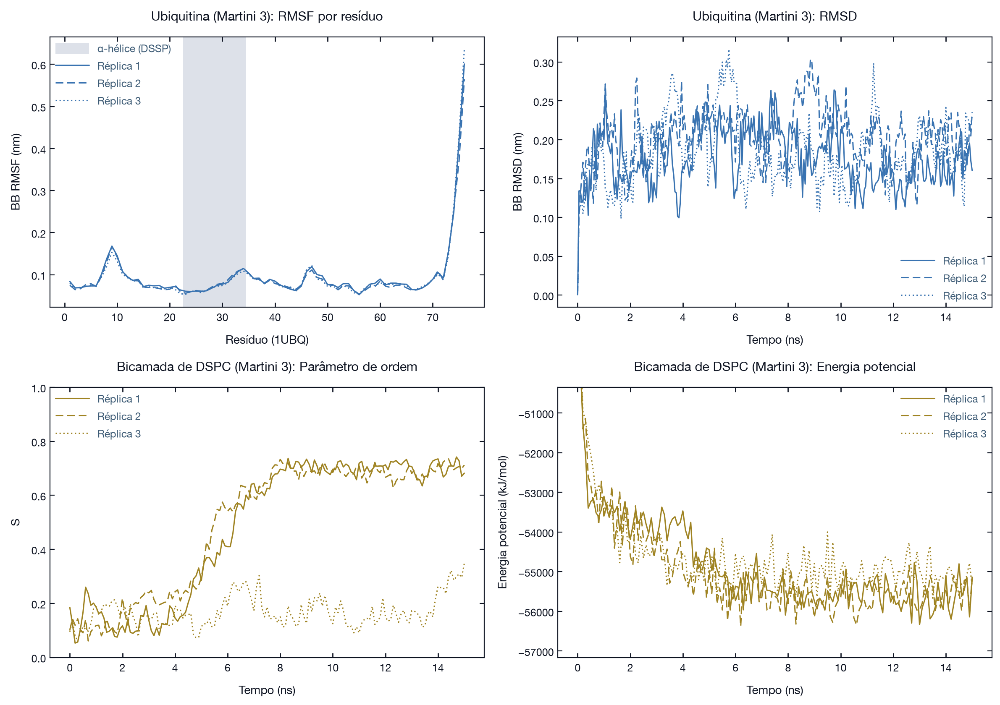
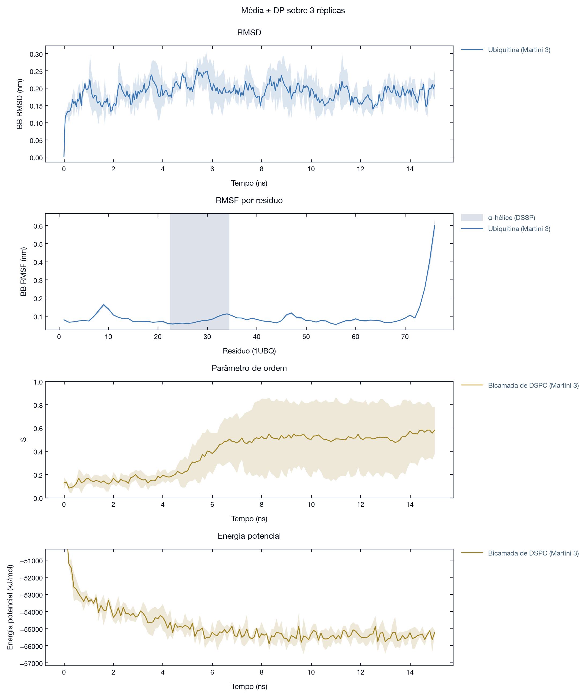
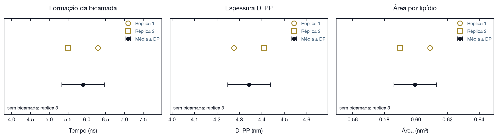

# Dinâmica Molecular com GROMACS: atomística e coarse-grained

Material de aula com dois notebooks executáveis no Google Colab.

| Notebook | Resolução | Sistemas | Colab |
|----------|-----------|----------|-------|
| `MD_GMX.ipynb` | all-atom, CHARMM36m | ubiquitina (1UBQ) em água | <a href="https://colab.research.google.com/drive/1mNCWToj7F1zcLeahWdKIuU3ttugzDtsq?usp=sharing" target="_blank"></a> |
| `MD_Martini.ipynb` | coarse-grained, Martini 3 | ubiquitina (1UBQ) em água; automontagem de bicamada de DSPC | <a href="https://colab.research.google.com/github/madsondeluna/aula_dinamica_molecular/blob/main/MD_Martini.ipynb" target="_blank"></a> |

O notebook atomístico segue o Exercício 1 de Lemkul (2024). O notebook Martini usa a mesma proteína, para comparar as resoluções, e reproduz o tutorial oficial de automontagem de bicamada do Martini 3.


## Índice

- [Como usar no Google Colab](#como-usar-no-google-colab)
- [Salvamento no Drive e retomada](#salvamento-no-drive-e-retomada)
- [Estrutura do repositório](#estrutura-do-repositório)
- [Fundamentos](#fundamentos)
- [Estimativas de tempo](#estimativas-de-tempo)
- [Notebook 1: ubiquitina all-atom (CHARMM36m)](#notebook-1-ubiquitina-all-atom-charmm36m)
- [Notebook 2: Martini 3](#notebook-2-martini-3)
- [Réplicas e sementes](#réplicas-e-sementes)
- [Tipos de arquivos GROMACS](#tipos-de-arquivos-gromacs)
- [Possíveis erros e soluções](#possíveis-erros-e-soluções)
- [Referências](#referências)


## Como usar no Google Colab

Requisitos: conta Google e navegador. Nada é instalado no computador.

1. Clique no botão do notebook na tabela acima.
2. Faça login com a conta Google.
3. Execute as células em ordem (`Shift + Enter`). As duas primeiras mantêm a sessão ativa e montam o Google Drive.

As simulações rodam na CPU; o Colab gratuito (2 vCPUs) é suficiente para os dois notebooks.

Parâmetros na segunda célula de `MD_Martini.ipynb`:

| Parâmetro | Padrão | Efeito |
|-----------|--------|--------|
| `REPLICA` | `1` | réplica usada (1, 2 ou 3); pasta `MyDrive/aula_martini/repN` |
| `USE_PRECOMPUTED` | `True` | baixa `results/repN.tar.gz` deste repositório; todas as etapas aparecem como concluídas e os cartões e gráficos saem em poucos minutos |

| Notebook | Modo | Tempo estimado no Colab gratuito |
|----------|------|----------------------------------|
| `MD_GMX.ipynb` | simulação completa | depende da CPU do Colab (170 ps de dinâmica all-atom) |
| `MD_Martini.ipynb` | `USE_PRECOMPUTED = True` | 5 a 10 min (instalação, download e análises) |
| `MD_Martini.ipynb` | `USE_PRECOMPUTED = False` | 1,5 a 2,5 h (Parte A: 15 ns; Parte B: 15 ns) |

O repositório e os notebooks são públicos: o Colab baixa os dados do GitHub sem login, a qualquer momento.


## Salvamento no Drive e retomada

| Notebook | Pasta no Drive |
|----------|----------------|
| `MD_GMX.ipynb` | `MyDrive/aula_dinamica_molecular` |
| `MD_Martini.ipynb` | `MyDrive/aula_martini` |

Comportamento de `MD_Martini.ipynb` ao reabrir:

| Situação | O que a célula faz |
|----------|--------------------|
| Etapa concluída (arquivo final existe e não está vazio) | pula e reaproveita |
| Simulação interrompida (`.tpr` e `.cpt` existem, `.gro` final não) | continua do checkpoint (`mdrun -cpi`, checkpoint a cada 5 min) |
| Etapa nunca executada | executa |

Uma simulação só conta como concluída quando o `.gro` final existe: o `mdrun` escreve esse arquivo apenas no último passo, então uma trajetória parcial não é confundida com uma completa.


## Estrutura do repositório

| Caminho | Conteúdo |
|---------|----------|
| `MD_GMX.ipynb` | notebook all-atom |
| `MD_Martini.ipynb` | notebook coarse-grained |
| `mdp/` | `ions.mdp`, `minim.mdp`, `nvt.mdp`, `npt.mdp`, `md.mdp` (CHARMM36m) |
| `mdp_martini/` | `minim.mdp`, `ions.mdp`, `npt_prot.mdp`, `md_prot.mdp`, `md_membrane.mdp`, `md_membrane_eq.mdp` (Martini 3) |
| `viz/stage_viewer.py`, `viz/stage.css` | cartões de etapa do notebook Martini |
| `viz/replica_plots.py` | gráficos de réplicas e de média ± DP |
| `viz/pure/` | tokens, padrões e tema matplotlib Pure Design usados pelos cartões e gráficos |
| `results/rep1.tar.gz`, `rep2`, `rep3` | triplicata do notebook Martini simulada localmente (todas as etapas) |
| `results/summary_repN.json` | séries e valores finais de cada réplica, usados na comparação |
| `results/pack_results.sh` | empacota as réplicas para o repositório |
| `imagens/fund_*.png` | ilustrações do capítulo Fundamentos |
| `imagens/martini_replicas*.png` | triplicata: réplicas, média ± DP e valores finais |
| `tools/build_martini_notebook.py` | gera `MD_Martini.ipynb` |
| `tools/make_figures.py` | gera `imagens/fund_*.png` |
| `tools/run_replicas.sh` | roda as três réplicas localmente (`runs/`, fora do git) |
| `lemkul-2024-...pdf` | artigo de referência |


## Fundamentos

Figuras geradas por `tools/make_figures.py`, usadas no capítulo *Fundamentos* de `MD_Martini.ipynb`. Esquemas ilustrativos usam funções analíticas ou modelos de brinquedo; coordenadas moleculares e quadros de trajetória são reais.

### Ciclo da MD e campo de força


$$U = \sum_{lig} \tfrac{1}{2}k_b(r-r_0)^2 + \sum_{ang} \tfrac{1}{2}k_\theta(\theta-\theta_0)^2 + \sum_{died} k_\phi[1+\cos(n\phi-\delta)] + \sum_{i<j} 4\varepsilon_{ij}\left[\left(\tfrac{\sigma_{ij}}{r_{ij}}\right)^{12}-\left(\tfrac{\sigma_{ij}}{r_{ij}}\right)^{6}\right] + \sum_{i<j} \frac{q_iq_j}{4\pi\varepsilon_0\varepsilon_r r_{ij}}$$


### Passo de tempo, condições periódicas e cutoff

| Resolução | Movimento mais rápido | Passo |
|-----------|-----------------------|-------|
| All-atom | estiramento X-H, período ~11 fs | 2 fs com `constraints = h-bonds` |
| United-atom | X-H polares | 2 fs |
| Martini 3 | ligações entre beads | 20 fs |


### Quatro resoluções

| Resolução | Representa | Exemplo | Ubiquitina (partículas na proteína) | Água | Passo |
|-----------|-----------|---------|-------------------------------------|------|-------|
| QM | núcleos e elétrons | DFT, Hartree-Fock | 1 231 núcleos | explícita, poucas moléculas | ~0,5 fs |
| All-atom | todos os átomos | CHARMM36m, AMBER | 1 231 | TIP3P, 3 sítios | 2 fs |
| United-atom | átomos pesados; CHₙ alifáticos unidos; H polares e aromáticos explícitos | GROMOS 54A7 | 762 | SPC, 3 sítios | 2 fs |
| Coarse-grained | beads de 2 a 4 átomos pesados | Martini 3 | 166 | W, 1 bead = 4 moléculas | 20 fs |

Contagens de all-atom e united-atom: teóricas, pela composição dos 76 resíduos a pH 7 (602 átomos pesados). DSPC (C₄₄H₈₈NO₈P): 142 átomos em all-atom, 54 partículas em united-atom, 12 beads em Martini 3.


| Pergunta | Resolução indicada |
|----------|--------------------|
| Reação química, quebra de ligação, estado eletrônico | QM |
| Ligações de hidrogênio, mecanismo enzimático, ligante no sítio ativo | all-atom |
| Dinâmica de proteína com custo menor por partícula | united-atom |
| Membranas, automontagem, agregação, sistemas grandes | coarse-grained |


### Paisagem energética

A MD passa a maior parte do tempo nos vales da energia livre e cruza barreiras com probabilidade proporcional a $e^{-\Delta G^{\ddagger}/k_BT}$.

| Resolução | Forma da paisagem |
|-----------|-------------------|
| QM | superfície de referência, rugosa; acessível só perto de um mínimo |
| All-atom | rugosa: muitas barreiras pequenas (rotâmeros, ligações de hidrogênio, rearranjo de águas) |
| United-atom | rugosidade menor nos grupos CHₙ; água inalterada |
| Coarse-grained | potencial de força média, liso: barreiras pequenas integradas nos parâmetros |
| Coarse-grained + rede elástica | poço único em torno da estrutura inicial |


| Consequência no CG | Efeito |
|--------------------|--------|
| Menos mínimos locais e atrito menor | difusão mais rápida; fator de cerca de 4 no tempo efetivo da água (Marrink *et al.*, 2007) |
| Vales definidos pela hidrofobicidade permanecem | automontagem, partição e agregação reproduzidas |
| Entropia dos graus removidos embutida nos parâmetros | balanço entalpia-entropia válido na faixa de temperatura da parametrização |
| Rede elástica | sem enovelamento nem troca de estrutura secundária |

### Tempos em resoluções diferentes não estão na mesma escala

Numa paisagem lisa, a mesma barreira é cruzada mais vezes no mesmo número de passos: 1 ns de Martini não equivale a 1 ns de all-atom, e o fator de conversão muda de processo para processo. Comparações entre resoluções usam eventos (formação da bicamada, contatos, estados visitados), não nanossegundos.


## Estimativas de tempo

Custo teórico por ns de simulação $\propto N \times n_{viz} \times 1/\Delta t$, com $n_{viz} = \rho \cdot \tfrac{4}{3}\pi r_c^3$. Sistema: ubiquitina solvatada da Parte A (caixa de 295,5 nm³); all-atom e united-atom com cada bead W trocado por 4 moléculas de 3 sítios.

| Resolução | Partículas | Vizinhos no cutoff | $r_c$ (nm) | Δt (fs) | Passos por ns | Custo por ns ÷ Martini |
|-----------|-----------|--------------------|-----------|---------|---------------|------------------------|
| All-atom | 26 293 | 644 | 1,2 | 2 | 500 000 | 1 691 |
| United-atom | 25 824 | 1 004 | 1,4 | 2 | 500 000 | 2 590 |
| Martini 3 | 2 304 | 43 | 1,1 | 20 | 50 000 | 1 |

O fator é um limite superior do ganho: PME, comunicação e partes que não escalam com $n_{viz}$ reduzem a diferença medida. O notebook converte esses fatores em tempo de parede com o ns/dia do Martini medido na própria réplica.

Desempenho medido do Martini 3 nas três réplicas (Apple M2, 6 threads OpenMP; varia com a carga da máquina):

| Sistema | Partículas | ns/dia | 15 ns levam |
|---------|-----------|--------|-------------|
| Ubiquitina | 2 304 | 707 a 1 576 | 14 a 31 min |
| Bicamada de DSPC | 3 072 | 2 467 a 2 670 | 8 a 9 min |

Aplicando o fator teórico de custo aos 14 min da ubiquitina, os mesmos 15 ns levariam da ordem de 16 dias em all-atom e 25 dias em united-atom, como limite superior.


## Notebook 1: ubiquitina all-atom (CHARMM36m)

Campo de força CHARMM36m (julho 2022), baixado pelo notebook:

```bash
wget "https://mackerell.umaryland.edu/download.php?filename=CHARMM_ff_params_files/charmm36-jul2022.ff.tgz" \
     -O charmm36-jul2022.ff.tgz
tar xzf charmm36-jul2022.ff.tgz
```

Parâmetros obrigatórios do CHARMM36m, presentes em todos os arquivos de `mdp/`:

```
vdw-modifier    = force-switch
rvdw-switch     = 1.0
rvdw            = 1.2
rcoulomb        = 1.2
rlist           = 1.4
dispcorr        = no
constraints     = h-bonds
```

| Etapa | Comando principal | Valor no notebook | Valor no artigo |
|-------|-------------------|-------------------|-----------------|
| Topologia | `gmx pdb2gmx -water tip3p` | CHARMM36m | CHARMM36m |
| Caixa | `gmx editconf -c -d 1.2 -bt cubic` | 1,2 nm | 1,2 nm |
| Solvatação | `gmx solvate -cs spc216.gro` | TIP3P | TIP3P |
| Íons | `gmx genion -conc` | 0,1 M NaCl | 0,1 M NaCl |
| Minimização | `gmx mdrun` (steep) | `emtol = 500` | `emtol = 500` |
| NVT | `nvt.mdp` | 20 ps, 298 K | 100 ps |
| NPT | `npt.mdp`, C-rescale | 50 ps, 1 bar | 500 ps |
| Produção | `md.mdp` | 100 ps | 50 + 50 ns |
| Análises | `gmx rms`, `rmsf`, `gyrate`, `mdmat`, `hbond`; DSSP via MDTraj | RMSD, RMSF, Rg, contatos, ligações H, DSSP | RMSD, RMSF, ligações H, DSSP |


## Notebook 2: Martini 3

### Ferramentas e arquivos

| Item | Fonte |
|------|-------|
| `vermouth` (martinize2), `mdtraj`, `py3Dmol` | `pip`, instalados pelo notebook |
| `martini_v3.0.0.itp`, `_ffbonded_v2.itp`, `_phospholipids_PC_v2.itp`, `_solvents_v1.itp`, `_ions_v1.itp` | [M3-Lipid-Parameters](https://github.com/Martini-Force-Field-Initiative/M3-Lipid-Parameters) |
| `water.gro` (400 W), `DPPC-em.gro` (1 lipídio) | biblioteca [cgmartini.nl](https://cgmartini.nl) |
| AMBER99SB-ILDN, GROMOS 54A7 | incluídos no GROMACS, usados só nas comparações |

### Parâmetros Martini 3 (todos os `.mdp` de `mdp_martini/`)

```
cutoff-scheme            = Verlet
verlet-buffer-tolerance  = 0.005
coulombtype              = reaction-field
rcoulomb                 = 1.1
epsilon_r                = 15
epsilon_rf               = 0
vdw_type                 = cutoff
vdw-modifier             = Potential-shift-verlet
rvdw                     = 1.1
```

### Parte A: ubiquitina

| Etapa | Comando ou arquivo | Valor |
|-------|--------------------|-------|
| Conversão CG | `martinize2 -ff martini3001 -dssp -elastic -ef 700 -el 0.5 -eu 0.9 -cys auto -p backbone` | 166 beads, rede elástica no backbone |
| Caixa | `gmx editconf -c -d 1.2 -bt cubic` | 1,2 nm |
| Solvatação | `gmx solvate -cs water.gro -radius 0.21` | água W |
| Íons | `gmx genion -np N -nn N`, com $N = 0{,}15 \times V \times 0{,}6022$ | 0,15 M NaCl |
| Minimização | `minim.mdp` | steep, `emtol = 1000` |
| NPT com restrição | `npt_prot.mdp`, `-DPOSRES` | 0,5 ns, dt 10 fs, 310 K, C-rescale `tau_p = 12` |
| Produção | `md_prot.mdp` | 15 ns, dt 20 fs |
| Análises | `gmx rms`, `rmsf`, `gyrate`, `mdmat` sobre o grupo `BB` | RMSD, RMSF, Rg, contatos |

`genion -conc` conta 1 bead W como 1 molécula de água e põe um quarto dos íons; o número de pares é calculado a partir do volume da caixa. DSSP e ligações de hidrogênio não se aplicam ao modelo CG.

### Parte B: automontagem de bicamada de DSPC

Composição do tutorial oficial *Lipid bilayers, Part I: Self-assembly*:

| Item | Valor |
|------|-------|
| Lipídios | 128 DSPC, `gmx insert-molecules -nmol 128 -radius 0.21 -try 500` |
| Água | 1 536 W (`gmx solvate -maxsol 1536`), 48 H₂O por lipídio (tutorial: 768 W) |
| Caixa inicial | 7,5 × 7,5 × 7,5 nm |
| Temperatura | 340 K, grupos `DSPC` e `W` |
| Pressão | C-rescale isotrópico, `tau_p = 4` |
| Duração | 15 ns (tutorial: 30 ns) |
| Equilibração | 5 ns, C-rescale semi-isotrópico (`md_membrane_eq.mdp`), após girar a normal para z; só se a bicamada se formou |

| Análise | Método |
|---------|--------|
| Energia potencial | `gmx energy` |
| Parâmetro de ordem $S(t)$ | maior autovalor de $Q = \langle \tfrac{3}{2}\hat{u}\hat{u}^T - \tfrac{1}{2}I \rangle$, $\hat{u}$ de PO4 ao fim das caudas |
| Normal da bicamada | autovetor de $Q$ |
| Estrutura formada | dimensionalidade de percolação do agregado de caudas através das imagens periódicas: 0 micela, 1 cilindro, 2 bicamada, 3 fase contínua |
| Critério de bicamada formada | dimensão 2 e $S$ final > 0,5; sem isso, espessura e área não se aplicam |
| Perfil de densidade, espessura $D_{PP}$ | histograma ao longo da normal, centrado por média circular das caudas |
| Área por lipídio | área do plano xy na equilibração semi-isotrópica / lipídios por monocamada |

Resultado da triplicata (15 ns de automontagem + 5 ns de equilibração semi-isotrópica):

| Réplica | Bicamada | Formação | $D_{PP}$ (nm) | Área por lipídio (nm²) |
|---------|----------|----------|---------------|------------------------|
| 1 | sim | 6,3 ns | 4,28 | 0,609 |
| 2 | sim | 5,5 ns | 4,41 | 0,590 |
| 3 | não (fase contínua; $S$ = 0,35) | | | |
| Média ± DP (n = 2) | | 5,9 ± 0,6 ns | 4,34 ± 0,09 | 0,599 ± 0,013 |


## Réplicas e sementes

Uma simulação é uma amostra. Para afirmar que um resultado é do sistema e não daquela trajetória, rode réplicas independentes e reporte média ± desvio entre elas.

Réplicas só são independentes se as sementes dos geradores aleatórios forem diferentes:

| Semente | Onde | O que sorteia | Se ficar fixa |
|---------|------|---------------|---------------|
| `gen_seed` | `.mdp`, com `gen_vel = yes` | velocidades iniciais | todas as réplicas partem das mesmas velocidades |
| `ld_seed` | `.mdp` | ruído do termostato estocástico (v-rescale) e da dinâmica de Langevin | o mesmo ruído a cada passo |
| `-seed` de `gmx insert-molecules` | linha de comando | posição e orientação das moléculas inseridas | mesma configuração inicial |
| `-seed` de `gmx genion` | linha de comando | quais moléculas de solvente viram íons | mesma distribuição inicial de íons |

| Regra | Motivo |
|-------|--------|
| Não use `gen_seed` fixo copiado de outro `.mdp` | mesma `.tpr` e mesmas sementes produzem a mesma trajetória; diferenças de arredondamento em paralelo só a separam depois de algum tempo |
| Sorteie com `-1` (ou `-seed 0`) e registre o valor | o GROMACS não grava `gen_seed` no `.tpr`; ele só aparece na saída do `grompp` (`Setting gen_seed to ...`) |
| Gere velocidades novas na primeira etapa de dinâmica | etapas com `gen_vel = no` herdam as velocidades do checkpoint; refazer só a produção não cria uma réplica |
| Uma pasta de trabalho por réplica | evita que o cache reaproveite arquivos de outra réplica |

`MD_Martini.ipynb` sorteia todas as sementes e grava os valores usados em `seeds.json`, na pasta de cada réplica. Para reproduzir uma corrida, copie os valores de `seeds.json` para os `.mdp` e para o `-seed` das ferramentas.

### Triplicata pré-computada

| Réplica | Pasta no Drive | Pacote no repositório |
|---------|----------------|-----------------------|
| 1 | `aula_martini/rep1` | `results/rep1.tar.gz` |
| 2 | `aula_martini/rep2` | `results/rep2.tar.gz` |
| 3 | `aula_martini/rep3` | `results/rep3.tar.gz` |

As três partem da mesma estrutura e diferem só nas sementes. A seção *Comparação entre as três réplicas* do notebook sobrepõe as curvas de cada réplica (linhas finas) à média ± desvio padrão (linha grossa e faixa): mesma tendência, momentos diferentes para cada evento.







Uso em aula: cada grupo escolhe uma `REPLICA`, com `USE_PRECOMPUTED = True` para ver os resultados na hora ou `False` para simular a própria réplica.


## Tipos de arquivos GROMACS

| Extensão | Conteúdo |
|----------|----------|
| `.gro` | coordenadas (nm) |
| `.pdb` | coordenadas no formato do Protein Data Bank (Å) |
| `.top` | topologia completa do sistema |
| `.itp` | topologia incluída: um tipo de molécula ou parâmetros auxiliares |
| `.mdp` | parâmetros da simulação |
| `.tpr` | entrada binária do `mdrun` (coordenadas, topologia, parâmetros) |
| `.edr` | energias |
| `.xtc` | trajetória comprimida |
| `.trr` | trajetória de alta precisão (coordenadas, velocidades, forças) |
| `.cpt` | checkpoint para retomar a simulação |
| `.ndx` | grupos de índice |
| `.xvg` | séries de dados das ferramentas de análise |


## Possíveis erros e soluções

| Erro | Causa | Solução |
|------|-------|---------|
| `number of coordinates in coordinate file does not match topology` | `.gro` e `.top` dessincronizados | refaça a etapa que adicionou ou removeu moléculas com `-p topol.top` |
| LINCS warnings, `Water molecule cannot be settled` | geometria ruim ou `dt` grande | confira a minimização; no all-atom, reduza `dt` para 0,001 |
| `pdb2gmx` não reconhece átomos | nomenclatura não padrão | use `-ignh` |
| Molécula quebrada na visualização | condições periódicas | `gmx trjconv -pbc mol -center -ur compact` |
| `-nb gpu` falha | sem GPU | remova a flag; `gmx mdrun -ntmpi 1` |
| Martini: minimização não converge a 100 kJ/mol/nm | rede elástica e geometria fixa das cadeias laterais | use `emtol = 1000` |
| Martini: concentração de íons quatro vezes menor | `genion -conc` conta 1 W como 1 molécula | calcule `-np` e `-nn` pelo volume |
| Martini: bicamada não se forma ($S$ final < 0,5) | formação não é garantida no tempo simulado | estenda com `gmx convert-tpr -s mem_md.tpr -extend 15000 -o mem_md.tpr`, apague `mem_md.gro` e execute B2; ou apague `mem_noW.gro` e `mem_*` para nova configuração |
| Martini: `grompp` acusa macro `FLEXIBLE` não usada | `-DFLEXIBLE` num sistema sem proteína | o `minim.mdp` deste repositório não define a macro |
| Célula pula uma etapa que deveria rodar | arquivo final de uma execução anterior na pasta | apague os arquivos da etapa ou use outra pasta de trabalho |


## Referências

- Lemkul, J. A. Introductory Tutorials for Simulating Protein Dynamics with GROMACS. *J. Phys. Chem. B* **2024**, *128*, 9418-9435. https://doi.org/10.1021/acs.jpcb.4c04901
- Souza, P. C. T. *et al.* Martini 3: a general purpose force field for coarse-grained molecular dynamics. *Nat. Methods* **2021**, *18*, 382-388. https://doi.org/10.1038/s41592-021-01098-3
- Kroon, P. C. *et al.* Martinize2 and Vermouth provide a unified framework for molecular topology generation. *eLife* **2025**, *12*, RP90627. https://doi.org/10.7554/eLife.90627
- Pedersen, K. B. *et al.* The Martini 3 lipidome: expanded and refined parameters improve lipid phase behavior. *ACS Cent. Sci.* **2025**, *11*, 1598-1610. https://doi.org/10.1021/acscentsci.5c00755
- Marrink, S. J.; Risselada, H. J.; Yefimov, S.; Tieleman, D. P.; de Vries, A. H. The MARTINI force field: coarse grained model for biomolecular simulations. *J. Phys. Chem. B* **2007**, *111*, 7812-7824. https://doi.org/10.1021/jp071097f
- Marrink, S. J.; Lindahl, E.; Edholm, O.; Mark, A. E. Simulation of the spontaneous aggregation of phospholipids into bilayers. *J. Am. Chem. Soc.* **2001**, *123*, 8638-8639. https://doi.org/10.1021/ja0159618
- McGibbon, R. T. *et al.* MDTraj: a modern open library for the analysis of molecular dynamics trajectories. *Biophys. J.* **2015**, *109*, 1528-1532. https://doi.org/10.1016/j.bpj.2015.08.015
- Tutorial Martini 3, *Lipid bilayers, Part I: Self-assembly*: https://cgmartini.nl/docs/tutorials/Martini3/LipidsI/
- Inputs do tutorial de Lemkul: https://github.com/Lemkul-Lab/gmx_tutorials_jpcb
- Manual do GROMACS: https://manual.gromacs.org/


## Licença

[MIT License](LICENSE).
