# Dinâmica Molecular: do átomo ao bead

Material de aula executável no Google Colab: uma proteína e uma membrana que se monta sozinha, em resolução coarse-grained (Martini 3), comparadas o tempo todo com as resoluções all-atom, united-atom e quântica.

| Notebook | Resolução | Sistemas | Colab |
|----------|-----------|----------|-------|
| `MD_Martini.ipynb` | coarse-grained, Martini 3 | ubiquitina (1UBQ) em água; automontagem de bicamada de DSPC | <a href="https://colab.research.google.com/github/madsondeluna/curso-dinamica-molecular-202x/blob/main/MD_Martini.ipynb" target="_blank"></a> |


| Autoria | |
|---|---|
| Autor | **Madson A. de Luna-Aragão**, MSc |
| Vínculos | Programa Interunidades de Pós-Graduação em Bioinformática, Universidade Federal de Minas Gerais (UFMG), Belo Horizonte, Brasil<br>CNRS, Institut de Biologie et Chimie des Protéines (IBCP), Lyon, França |
| E-mail | [madsondeluna@gmail.com](mailto:madsondeluna@gmail.com) |
| Site | [madsondeluna.com](https://madsondeluna.com) |
| GitHub | [github.com/madsondeluna](https://github.com/madsondeluna) |
| LinkedIn | [linkedin.com/in/madsonaragao](https://www.linkedin.com/in/madsonaragao/) |
| Repositório | [madsondeluna/curso-dinamica-molecular-202x](https://github.com/madsondeluna/curso-dinamica-molecular-202x) |

## Índice

- [Roteiro da aula](#roteiro-da-aula)
- [Como usar no Google Colab](#como-usar-no-google-colab)
- [1. O que a dinâmica molecular faz](#1-o-que-a-dinâmica-molecular-faz)
- [2. Quatro resoluções: QM, all-atom, united-atom e coarse-grained](#2-quatro-resoluções-qm-all-atom-united-atom-e-coarse-grained)
- [3. Paisagem energética](#3-paisagem-energética)
- [4. Quanto custa cada resolução](#4-quanto-custa-cada-resolução)
- [5. Parte A: ubiquitina em Martini 3](#5-parte-a-ubiquitina-em-martini-3)
- [6. Parte B: automontagem de uma bicamada](#6-parte-b-automontagem-de-uma-bicamada)
- [Membranas reais: células normais, de câncer e bactérias](#membranas-reais-células-normais-de-câncer-e-bactérias)
- [7. Réplicas e sementes](#7-réplicas-e-sementes)
- [Material legado: curso atomístico](#material-legado-curso-atomístico)
- [Referência técnica](#referência-técnica)
- [Referências](#referências)
- [Autoria](#autoria)


## Roteiro da aula

| Bloco | Conteúdo | Material |
|-------|----------|----------|
| 1 | Ciclo da MD, campo de força, passo de tempo, caixa periódica | seção 1; capítulo *Fundamentos* do notebook |
| 2 | A mesma molécula em quatro resoluções; mapeamento 4:1 | seção 2 |
| 3 | Paisagem energética, funil e por que os relógios não se comparam | seção 3 |
| 4 | Custo de cada resolução | seção 4 |
| 5 | Prática: ubiquitina coarse-grained, do PDB à análise | `MD_Martini.ipynb`, Parte A |
| 6 | Prática: lipídios aleatórios formando uma bicamada | `MD_Martini.ipynb`, Parte B |
| 6b | Membranas reais: células normais, de câncer e bactérias; peptídeos antimicrobianos | seção *Membranas reais* |
| 7 | Três réplicas: o que se repete e o que é acaso | seção 7; seção de réplicas do notebook |


## Como usar no Google Colab

Requisitos: conta Google e navegador. Nada é instalado no computador. Clique no botão do notebook, faça login e execute as células em ordem (`Shift + Enter`). As duas primeiras células mantêm a sessão ativa e montam o Google Drive.

O Colab baixa tudo deste repositório público: parâmetros, visualizadores, as três réplicas já simuladas e as imagens.

Parâmetros na segunda célula de `MD_Martini.ipynb`:

| Parâmetro | Padrão | Efeito |
|-----------|--------|--------|
| `REPLICA` | `1` | réplica usada (1, 2 ou 3); pasta `MyDrive/aula_martini/repN` |
| `USE_PRECOMPUTED` | `True` | baixa `results/repN.tar.gz`: todas as etapas aparecem como concluídas e os cartões, gráficos e visualizações 3D saem em poucos minutos |

| Notebook | Modo | Tempo no Colab gratuito |
|----------|------|-------------------------|
| `MD_Martini.ipynb` | `USE_PRECOMPUTED = True` | 5 a 10 min (instalação, download e análises) |
| `MD_Martini.ipynb` | `USE_PRECOMPUTED = False` | 1,5 a 2,5 h (Parte A: 15 ns; Parte B: 15 + 5 ns) |

Ao reabrir com o Drive montado, cada etapa concluída é reaproveitada e uma simulação interrompida continua do último checkpoint. Uma etapa de MD só conta como concluída quando o `.gro` final existe.


## 1. O que a dinâmica molecular faz

A MD resolve as equações de Newton para todas as partículas, passo a passo. A cada passo $\Delta t$, calcula as forças a partir da energia potencial, atualiza velocidades e depois posições. O GROMACS usa o integrador leap-frog, que calcula as velocidades no meio do passo.

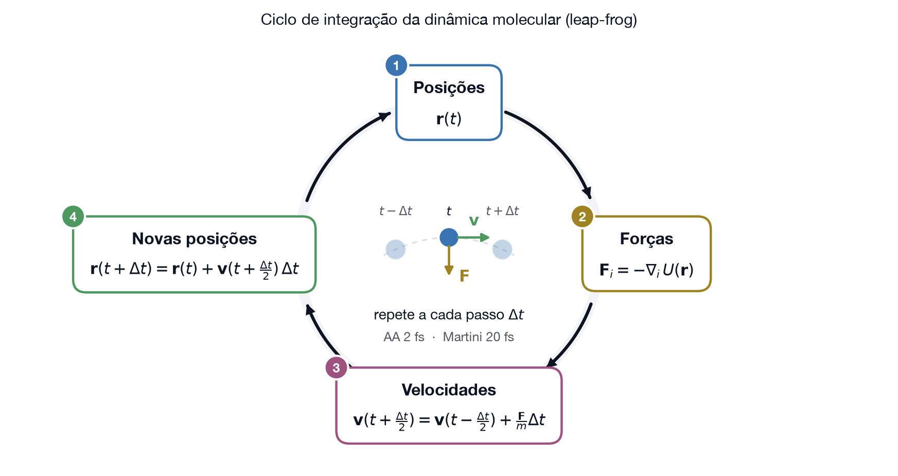

A energia potencial é a soma de termos simples. Os **ligados** mantêm a geometria da molécula; os **não ligados** agem entre pares: Lennard-Jones (repulsão de curto alcance e atração de van der Waals) e Coulomb (cargas). Um campo de força é o conjunto de parâmetros desses termos para cada tipo de partícula.

$$U = \sum_{lig} \tfrac{1}{2}k_b(r-r_0)^2 + \sum_{ang} \tfrac{1}{2}k_\theta(\theta-\theta_0)^2 + \sum_{died} k_\phi[1+\cos(n\phi-\delta)] + \sum_{i \lt j} 4\varepsilon_{ij}\left[\left(\tfrac{\sigma_{ij}}{r_{ij}}\right)^{12}-\left(\tfrac{\sigma_{ij}}{r_{ij}}\right)^{6}\right] + \sum_{i \lt j} \frac{q_iq_j}{4\pi\varepsilon_0\varepsilon_r r_{ij}}$$

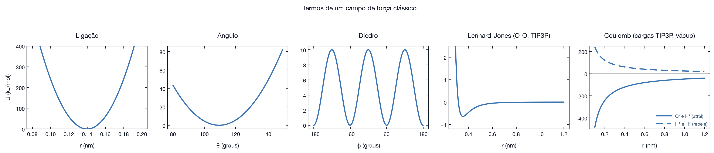

O passo de tempo é limitado pelo movimento mais rápido do sistema. Em all-atom é o estiramento de ligações com hidrogênio (período de ~11 fs), por isso 2 fs com essas ligações restritas. No Martini não há hidrogênios e as ligações entre beads vibram devagar: 20 fs funcionam.

| Resolução | Movimento mais rápido | Passo |
|-----------|-----------------------|-------|
| All-atom | estiramento X-H, período ~11 fs | 2 fs com `constraints = h-bonds` |
| United-atom | X-H polares | 2 fs |
| Martini 3 | ligações entre beads | 20 fs |

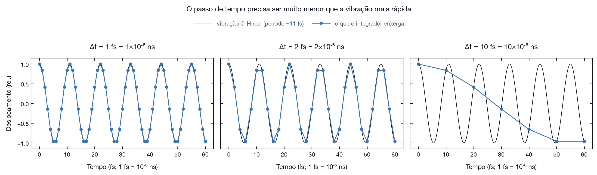

A caixa simulada se repete em todas as direções, o que elimina superfícies artificiais. Cada partícula interage só com vizinhas dentro do raio de corte $r_c$, que pode incluir cópias da caixa ao lado.

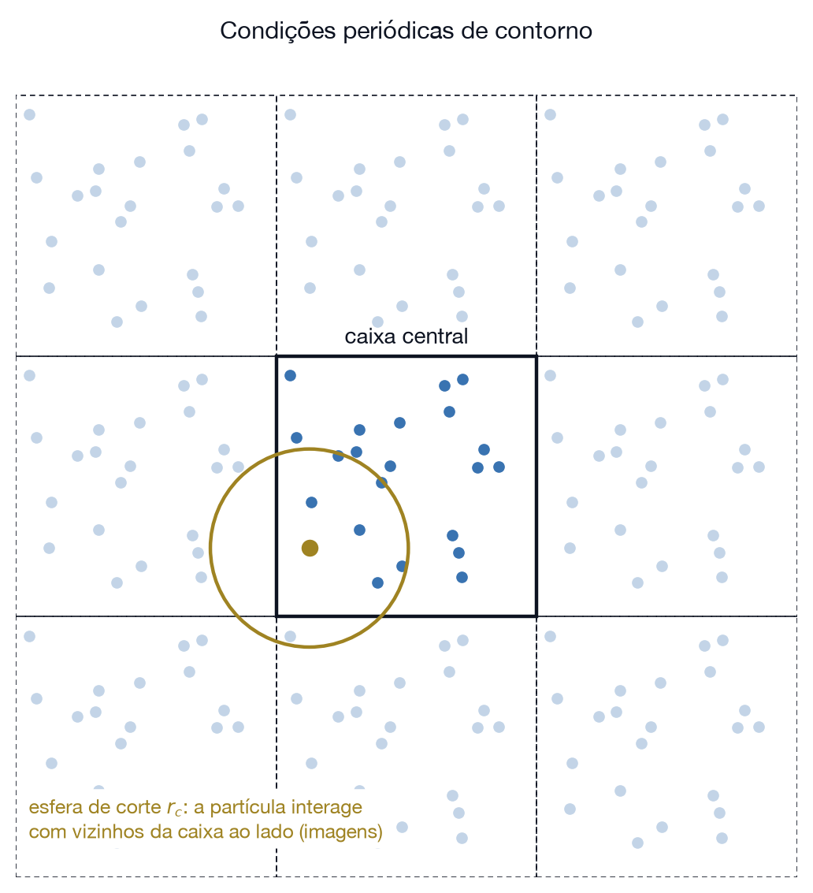

Minimizar e simular são coisas diferentes: a minimização desce até o mínimo mais próximo; a dinâmica a temperatura finita visita vales e cruza barreiras.

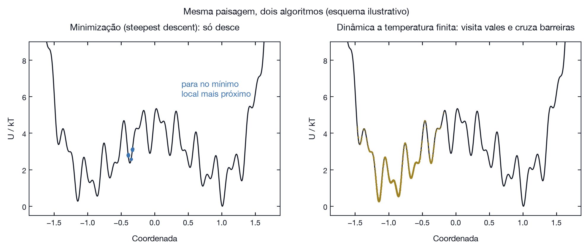


## 2. Quatro resoluções: QM, all-atom, united-atom e coarse-grained

| Resolução | Representa | Exemplo | Ubiquitina (partículas na proteína) | Água | Passo |
|-----------|-----------|---------|-------------------------------------|------|-------|
| QM | núcleos e elétrons | DFT, Hartree-Fock | 1 231 núcleos | poucas moléculas explícitas | ~0,5 fs |
| All-atom | todos os átomos | CHARMM36m, AMBER | 1 231 | TIP3P, 3 sítios | 2 fs |
| United-atom | átomos pesados; CHₙ alifáticos unidos; H polares e aromáticos explícitos | GROMOS 54A7 | 762 | SPC, 3 sítios | 2 fs |
| Coarse-grained | beads de 2 a 4 átomos pesados | Martini 3 | 166 | W, 1 bead = 4 moléculas | 20 fs |

Contagens de all-atom e united-atom pela composição dos 76 resíduos a pH 7 (602 átomos pesados). DSPC (C₄₄H₈₈NO₈P): 142 átomos em all-atom, 54 partículas em united-atom, 12 beads em Martini 3. Só a QM descreve reações químicas; as outras três têm ligações fixas e diferem em quanto detalhe guardam.

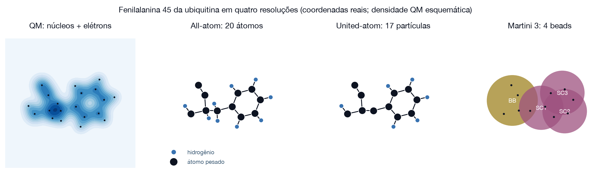

O mapeamento Martini depende do resíduo: glicina tem só o bead de backbone; aromáticos têm três ou quatro beads de cadeia lateral.

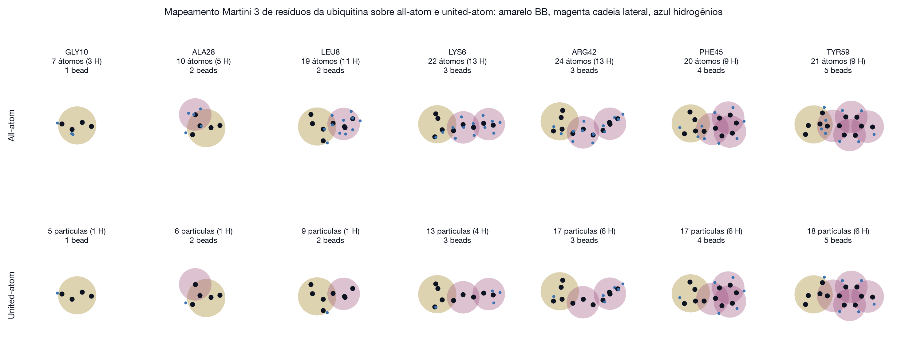

Quatro moléculas de água viram um bead W. O bead é maior que um átomo (σ = 0,47 nm contra 0,315 nm do oxigênio do TIP3P) e o poço de Lennard-Jones é mais fundo, porque representa a atração média de quatro moléculas.

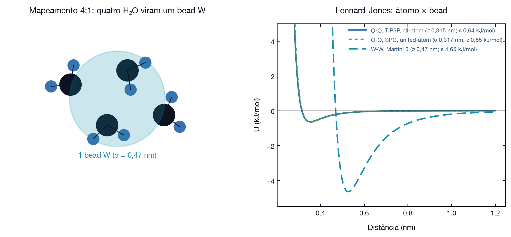

| Pergunta | Resolução indicada |
|----------|--------------------|
| Reação química, quebra de ligação, estado eletrônico | QM |
| Ligações de hidrogênio, mecanismo enzimático, ligante no sítio ativo | all-atom |
| Dinâmica de proteína com custo menor por partícula | united-atom |
| Membranas, automontagem, agregação, sistemas grandes | coarse-grained |

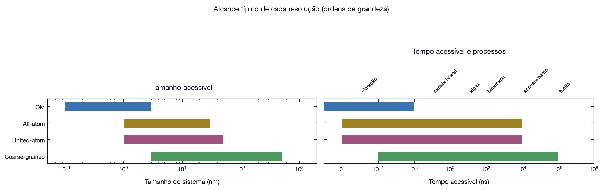


## 3. Paisagem energética

A simulação caminha sobre uma paisagem de energia livre: passa a maior parte do tempo nos vales e cruza barreiras com probabilidade proporcional a $e^{-\Delta G^{\ddagger}/k_BT}$. Ao agrupar átomos em beads, o CG integra a rugosidade (rotâmeros, ligações de hidrogênio, rearranjo de águas) e mantém os vales principais.

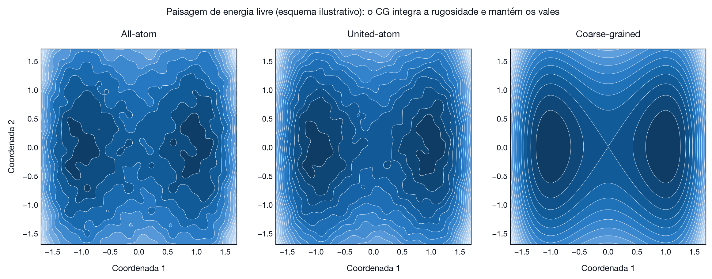

| Resolução | Forma da paisagem |
|-----------|-------------------|
| QM | superfície de referência, rugosa; acessível só perto de um mínimo |
| All-atom | rugosa: muitas barreiras pequenas |
| United-atom | rugosidade menor nos grupos CHₙ; água inalterada |
| Coarse-grained | potencial de força média, liso |
| Coarse-grained + rede elástica | poço único em torno da estrutura inicial |

No enovelamento, a paisagem tem forma de funil: larga em cima (muitas conformações desenoveladas) e estreita no fundo (o estado nativo). A rede elástica do Martini troca o funil por um poço único: a proteína fica perto da estrutura inicial e não enovela nem desenovela.

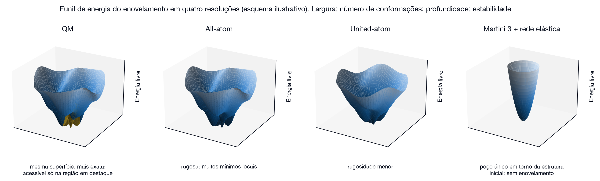

Numa paisagem lisa, a mesma barreira é cruzada mais vezes no mesmo número de passos: **1 ns de Martini não equivale a 1 ns de all-atom**. Para a água, Marrink *et al.* (2007) estimaram um fator de cerca de 4, mas o fator muda de processo para processo. Comparações entre resoluções usam eventos (formação da bicamada, contatos, estados visitados), não nanossegundos.

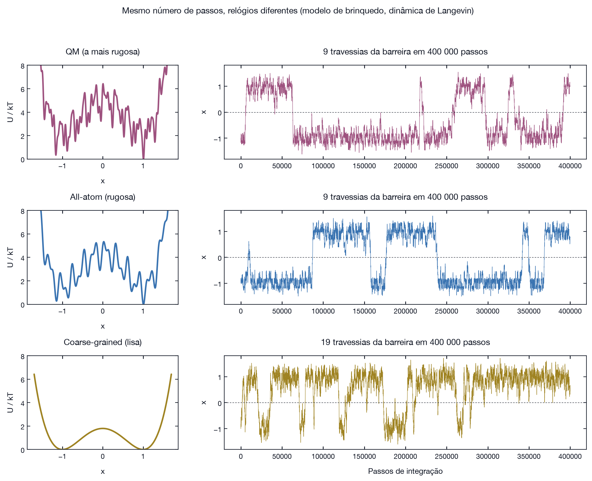

| Consequência no CG | Efeito |
|--------------------|--------|
| Menos mínimos locais e atrito menor | difusão mais rápida |
| Vales definidos pela hidrofobicidade permanecem | automontagem, partição e agregação reproduzidas |
| Entropia dos graus removidos embutida nos parâmetros | balanço entalpia-entropia válido na faixa de temperatura da parametrização |
| Rede elástica | sem enovelamento nem troca de estrutura secundária |


## 4. Quanto custa cada resolução

O custo por ns de simulação é aproximadamente $N \times n_{viz} \times 1/\Delta t$, com $n_{viz} = \rho \cdot \tfrac{4}{3}\pi r_c^3$ vizinhos dentro do cutoff. Sistema: a ubiquitina solvatada da Parte A (caixa de 295,5 nm³), com cada bead W trocado por 4 moléculas de 3 sítios em all-atom e united-atom.

| Resolução | Partículas | Vizinhos no cutoff | $r_c$ (nm) | Δt (fs) | Passos por ns | Custo por ns ÷ Martini |
|-----------|-----------|--------------------|-----------|---------|---------------|------------------------|
| All-atom | 26 293 | 644 | 1,2 | 2 | 500 000 | 1 691 |
| United-atom | 25 824 | 1 004 | 1,4 | 2 | 500 000 | 2 590 |
| Martini 3 | 2 304 | 43 | 1,1 | 20 | 50 000 | 1 |

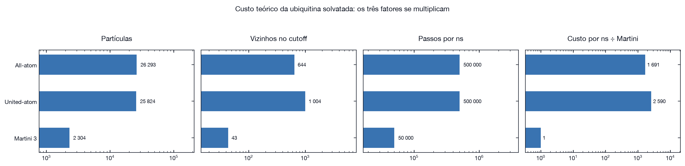

O united-atom tem quase o mesmo número de partículas do all-atom porque a água, que é a maior parte do sistema, continua com 3 sítios. O fator é um limite superior do ganho: PME, comunicação e partes que não escalam com $n_{viz}$ reduzem a diferença medida.

Desempenho medido do Martini 3 nas três réplicas (Apple M2, 6 threads OpenMP; varia com a carga da máquina):

| Sistema | Partículas | ns/dia | 15 ns levam |
|---------|-----------|--------|-------------|
| Ubiquitina | 2 304 | 707 a 1 576 | 14 a 31 min |
| Bicamada de DSPC | 3 072 | 2 467 a 2 670 | 8 a 9 min |

Aplicando o fator de custo aos 14 min da ubiquitina, os mesmos 15 ns levariam da ordem de 16 dias em all-atom e 25 dias em united-atom, como limite superior.


## 5. Parte A: ubiquitina em Martini 3

**Por que a ubiquitina.** É uma proteína pequena (76 resíduos, carga líquida zero) presente em todas as células eucarióticas. Ela funciona como etiqueta: enzimas ligam a Gly76 da cauda C-terminal a lisinas de outras proteínas, e cadeias ligadas pela Lys48 marcam a proteína para degradação no proteassomo. Esse sistema é alvo terapêutico: o bortezomibe, inibidor do proteassomo, foi aprovado em 2003 para o mieloma múltiplo (Bross *et al.*, 2004). É a mesma proteína do curso atomístico (material legado). Cada etapa do notebook termina com um cartão de etapa: visualização 3D interativa, explicação, números do sistema e a mesma etapa nas três resoluções.

| Etapa | Comando ou arquivo | Valor |
|-------|--------------------|-------|
| Conversão CG | `martinize2 -ff martini3001 -dssp -elastic -ef 700 -el 0.5 -eu 0.9 -cys auto -p backbone` | 166 beads, rede elástica no backbone |
| Caixa | `gmx editconf -c -d 1.2 -bt cubic` | 1,2 nm |
| Solvatação | `gmx solvate -cs water.gro -radius 0.21` | água W |
| Íons | `gmx genion -np N -nn N`, com $N = 0{,}15 \times V \times 0{,}6022$ | 0,15 M NaCl |
| Minimização | `minim.mdp` | steep, `emtol = 1000` |
| NPT com restrição | `npt_prot.mdp`, `-DPOSRES` | 0,5 ns, dt 10 fs, 310 K, C-rescale `tau_p = 12` |
| Produção | `md_prot.mdp` | 15 ns, dt 20 fs |
| Análises | `gmx rms`, `rmsf`, `gyrate`, `mdmat` no grupo `BB` | RMSD, RMSF, Rg, contatos |

O `genion -conc` conta 1 bead W como 1 molécula de água e poria um quarto dos íons; o número de pares vem do volume da caixa. DSSP e ligações de hidrogênio não se aplicam ao modelo CG: a estrutura secundária é parâmetro da topologia.

Nas três réplicas, a rede elástica mantém o enovelamento (RMSD de 0,17 a 0,21 nm) e a região mais móvel é a cauda C-terminal, resíduos 74 a 76, como na simulação atomística.

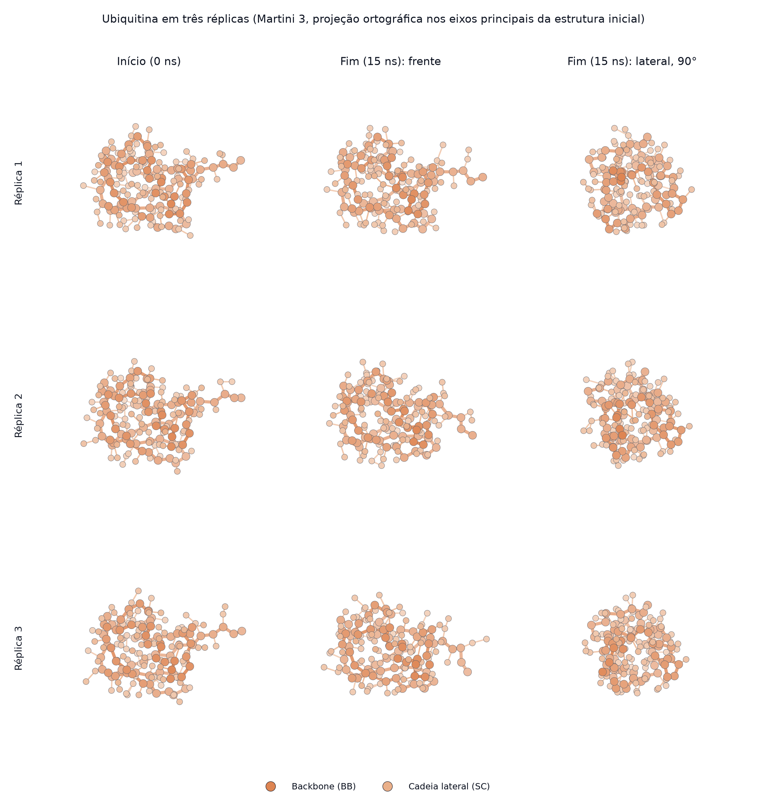


## 6. Parte B: automontagem de uma bicamada

Lipídios distribuídos ao acaso em água se organizam sozinhos em bicamada, guiados pelo efeito hidrofóbico. Na Parte A a estrutura estava dada; aqui nada é imposto. É o mesmo princípio que forma as membranas das células, os lipossomos usados para entregar fármacos e as nanopartículas lipídicas das vacinas de mRNA.

| Item | Valor |
|------|-------|
| Lipídios | 128 DSPC, `gmx insert-molecules -nmol 128 -radius 0.21 -try 500` |
| Água | 1 536 W (`gmx solvate -maxsol 1536`), 48 H₂O por lipídio (tutorial oficial: 768 W) |
| Caixa inicial | 7,5 × 7,5 × 7,5 nm |
| Temperatura | 340 K, acima da transição gel-fluido do DSPC |
| Automontagem | 15 ns, C-rescale isotrópico, `tau_p = 4` |
| Equilibração | 5 ns, C-rescale semi-isotrópico (`md_membrane_eq.mdp`), com a normal girada para z; só se a bicamada se formou |

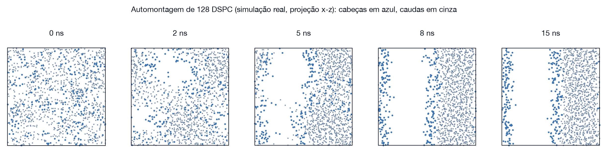

| Análise | Método |
|---------|--------|
| Parâmetro de ordem $S(t)$ | maior autovalor de $Q = \langle \tfrac{3}{2}\hat{u}\hat{u}^T - \tfrac{1}{2}I \rangle$, $\hat{u}$ de PO4 ao fim das caudas; ~0,2 aleatório, ~0,7 bicamada |
| Estrutura formada | dimensionalidade de percolação do agregado de caudas através das imagens periódicas: 0 micela, 1 cilindro, 2 bicamada, 3 fase contínua |
| Critério de bicamada formada | dimensão 2 e $S$ final > 0,5 |
| Espessura $D_{PP}$ | distância entre os picos de PO4 das duas monocamadas, na equilibração |
| Área por lipídio | área do plano xy na equilibração ÷ lipídios por monocamada |

A automontagem usa acoplamento isotrópico porque ainda não há membrana. Com a bicamada formada, o acoplamento isotrópico prende a área à forma cúbica da caixa; na equilibração semi-isotrópica o plano e a normal se ajustam separadamente e a área relaxa (o plano da réplica 1 passou de 7,14 para 6,26 nm).

Resultado das três réplicas:

| Réplica | Bicamada | Formação | $D_{PP}$ (nm) | Área por lipídio (nm²) | $S$ final | Energia final (kJ/mol) |
|---------|----------|----------|---------------|------------------------|-----------|------------------------|
| 1 | sim | 6,3 ns | 4,28 | 0,609 | 0,68 | −55 509 |
| 2 | sim | 5,5 ns | 4,41 | 0,590 | 0,71 | −55 504 |
| 3 | não (fase contínua) | | | | 0,35 | −55 188 |
| Média ± DP (n = 2) | | 5,9 ± 0,6 ns | 4,34 ± 0,09 | 0,599 ± 0,013 | | |

A réplica 3 terminou cerca de 320 kJ/mol acima das outras duas: a bicamada é o vale mais fundo da paisagem e a réplica 3 parou num vale mais raso. Seu $S$ ficou em ~0,15 até 13,5 ns e começou a subir no último nanossegundo.

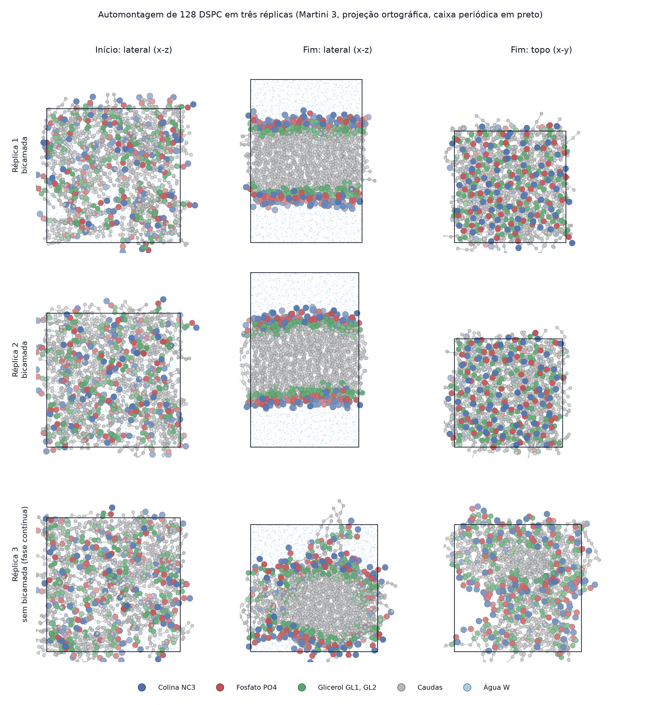


## Membranas reais: células normais, de câncer e bactérias

A bicamada desta aula tem um único lipídio. Membranas de verdade misturam dezenas, e a composição de cada lado é diferente. Essa diferença decide como moléculas e fármacos interagem com cada tipo de célula.

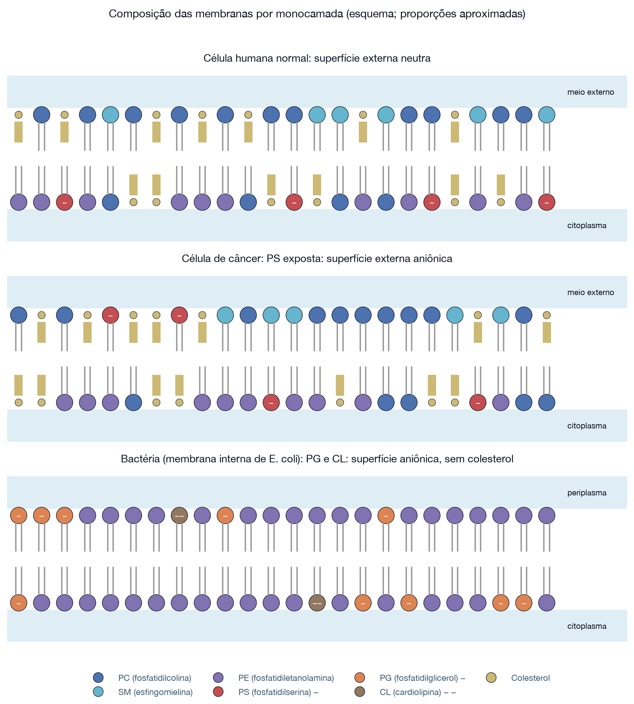

| Membrana | Monocamada externa | Monocamada interna | Superfície externa |
|----------|--------------------|--------------------|--------------------|
| Célula humana normal | PC, esfingomielina, colesterol | PE, PS, PC, colesterol | neutra |
| Célula de câncer | PC, esfingomielina, colesterol e **PS exposta** | PE, PS, PC, colesterol | aniônica |
| Bactéria (membrana interna de *E. coli*) | PE, PG, cardiolipina | igual à externa | aniônica, sem colesterol |

**Célula normal.** A célula gasta energia para manter a PS, de carga negativa, só na face interna; por fora a membrana é neutra e rica em colesterol (van Meer *et al.*, 2008).

**Célula de câncer.** Muitas células tumorais perdem essa assimetria: células de melanoma e carcinoma mostraram de 3 a 7 vezes mais PS na face externa que queratinócitos normais (Utsugi *et al.*, 1991). A superfície negativa é explorada por peptídeos anticâncer e por moléculas que reconhecem PS.

**Bactéria.** A membrana interna de *E. coli* é formada principalmente por PE, com PG e cardiolipina, ambos negativos, e não tem colesterol; a composição varia entre espécies e condições (Sohlenkamp e Geiger, 2016).

**Exemplo translacional: peptídeos antimicrobianos.** Peptídeos do sistema imune, como magainina e LL-37, são catiônicos. São atraídos pelas superfícies negativas das bactérias e interagem pouco com a superfície neutra e rica em colesterol das células humanas, uma das bases da seletividade buscada em novos antibióticos (Zasloff, 2002). Todos esses lipídios têm parâmetros no Martini 3 (M3-Lipid-Parameters): trocar a bicamada desta aula por uma membrana bacteriana ou tumoral é mudar a composição de entrada.


### Domínios laterais: balsas lipídicas

A membrana também não é homogênea no plano. Esfingomielina, colesterol e lipídios de caudas saturadas se agrupam em domínios mais ordenados e mais espessos (fase líquido-ordenada, Lo), cercados por fosfolipídios insaturados em fase líquido-desordenada (Ld). Esses domínios, as balsas lipídicas, são dinâmicos, têm dimensões nanométricas e concentram proteínas de sinalização (Simons e Ikonen, 1997; Lingwood e Simons, 2010).

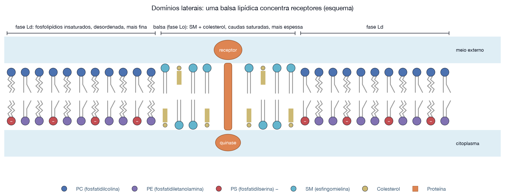

**Câncer.** Células tumorais costumam acumular colesterol na membrana. As balsas reúnem receptores e moléculas de sinalização ligadas a crescimento, adesão, migração e invasão, e alterar o colesterol das balsas é estudado como estratégia terapêutica (Vona *et al.*, 2021).

**No Martini.** Uma mistura de PC saturada, PC insaturada e colesterol se separa sozinha em fases Lo e Ld em simulações Martini, com propriedades próximas das medidas experimentais (Risselada e Marrink, 2008). É o mesmo tipo de automontagem da Parte B, com três componentes em vez de um.


### Insaturação das caudas: inflamação e câncer

Uma ligação dupla *cis* dobra a cauda. Caudas saturadas, como as 18:0 do DSPC desta aula, ficam retas e empacotam densamente; caudas poli-insaturadas, como o araquidonato (20:4, quatro duplas ligações), dobram, ocupam mais área e deixam a membrana mais fluida. As duplas ligações também são o ponto em que a cauda reage com oxigênio.

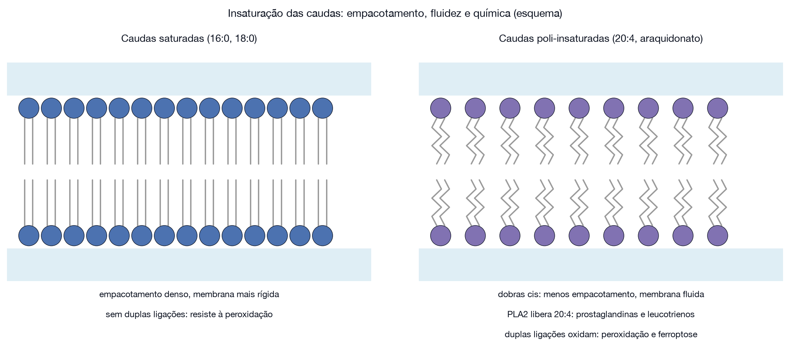

**Inflamação.** A fosfolipase A2 libera o araquidonato da posição *sn*-2 dos fosfolipídios. Ciclo-oxigenases e lipoxigenases o convertem em prostaglandinas e leucotrienos, mediadores da inflamação (Dennis e Norris, 2015). Anti-inflamatórios não esteroides, como o ibuprofeno, inibem as ciclo-oxigenases.

**Câncer.** Tumores com lipogênese ativa produzem os próprios ácidos graxos e têm fosfolipídios mais saturados. Com menos duplas ligações, a membrana sofre menos peroxidação, e as células ficam mais protegidas de radicais livres e de quimioterápicos como a doxorrubicina (Rysman *et al.*, 2010). No sentido oposto, PE com araquidonato ou adrenato oxidados dispara a ferroptose, uma forma de morte celular regulada que é alvo de pesquisa de novos fármacos (Kagan *et al.*, 2017).

**No Martini.** A insaturação aparece no tipo de bead da cauda: o DSPC (18:0) só tem beads C; o DOPC (18:1) tem um bead D no lugar da dupla ligação. Trocar DSPC por DOPC na Parte B é trocar uma cauda reta por uma cauda dobrada.


### Proteínas de membrana: receptores e transportadores

De 20 a 30% dos genes da maioria dos genomas codificam proteínas de membrana (Krogh *et al.*, 2001). Elas atravessam o núcleo hidrofóbico da bicamada, de cerca de 3 nm, com hélices de resíduos hidrofóbicos.

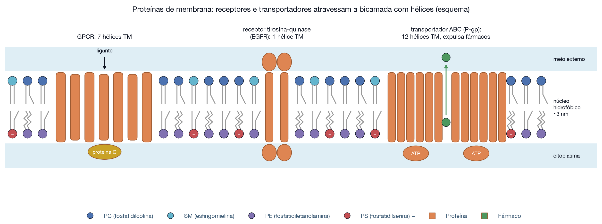

**Receptores.** Os receptores acoplados à proteína G (GPCRs) têm sete hélices transmembrana; cerca de 34% dos fármacos aprovados pela FDA agem em GPCRs (Hauser *et al.*, 2017). Os receptores tirosina-quinase, como o EGFR, têm uma hélice por monômero e sinalizam quando dois monômeros se juntam; o EGFR é alvo de terapias contra câncer.

**Transportadores.** A glicoproteína P (P-gp, ABCB1) usa ATP para expulsar quimioterápicos da célula. Sua superexpressão é uma das causas de resistência a múltiplos fármacos em tumores (Gottesman *et al.*, 2002).

**No Martini.** Simulações de dez proteínas de membrana em uma membrana plasmática com mais de 60 tipos de lipídio mostraram que cada proteína enriquece ou depleta lipídios específicos ao seu redor (Corradi *et al.*, 2018). O martinize2 desta aula converte proteínas de membrana do mesmo jeito que converteu a ubiquitina; o passo extra é inseri-las na bicamada.


### Peptídeos antimicrobianos em membranas bacterianas

Peptídeos antimicrobianos (AMPs) como magainina e LL-37 são curtos, catiônicos e anfipáticos: uma face concentra lisinas e argininas, a outra é hidrofóbica. A face positiva se liga ao PG e à cardiolipina da bactéria; a face hidrofóbica entra no núcleo da bicamada. Três modelos descrevem o que acontece depois (Brogden, 2005; Shai, 2002):

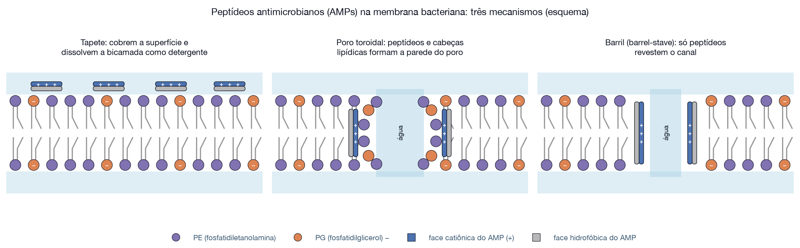

- **Tapete**: os peptídeos cobrem a superfície e, acima de uma concentração limite, desfazem a bicamada como um detergente.
- **Poro toroidal**: os peptídeos entram na membrana e arrastam as cabeças dos lipídios, que passam a forrar o poro junto com eles.
- **Barril**: os peptídeos se alinham como as aduelas de um barril e formam sozinhos a parede de um canal.

Parte dos AMPs atravessa a membrana sem rompê-la e age em alvos internos, como a síntese de DNA, de proteínas ou da parede celular (Brogden, 2005). A seletividade vem da carga: a superfície bacteriana é aniônica, e a face externa das células humanas é neutra e rica em colesterol.

**No Martini.** A formação de um poro envolve vários peptídeos e centenas de lipídios, numa escala de tempo além do alcance usual do all-atom; por isso esses processos costumam ser estudados em coarse-grained, com o peptídeo convertido pelo martinize2 e a membrana bacteriana montada com PE, PG e cardiolipina.

## 7. Réplicas e sementes

Uma simulação é uma amostra de uma trajetória possível. Uma conclusão tirada de uma única corrida pode ser acaso daquela trajetória. Com réplicas independentes, cada resultado vira média ± desvio, e um evento raro em uma só fica visível como raro.

Réplicas só são independentes se as sementes dos geradores aleatórios forem diferentes:

| Semente | Onde | O que sorteia | Se ficar fixa |
|---------|------|---------------|---------------|
| `gen_seed` | `.mdp`, com `gen_vel = yes` | velocidades iniciais | todas as réplicas partem das mesmas velocidades |
| `ld_seed` | `.mdp` | ruído do termostato estocástico (v-rescale) | o mesmo ruído a cada passo |
| `-seed` de `gmx insert-molecules` | linha de comando | posição e orientação das moléculas inseridas | mesma configuração inicial |
| `-seed` de `gmx genion` | linha de comando | quais moléculas de solvente viram íons | mesma distribuição inicial de íons |

| Regra | Motivo |
|-------|--------|
| Não usar `gen_seed` fixo copiado de outro `.mdp` | mesma `.tpr` e mesmas sementes produzem a mesma trajetória |
| Sortear com `-1` (ou `-seed 0`) e registrar o valor | o GROMACS não grava `gen_seed` no `.tpr`; ele só aparece na saída do `grompp` |
| Gerar velocidades novas na primeira etapa de dinâmica | etapas com `gen_vel = no` herdam as velocidades do checkpoint |
| Uma pasta de trabalho por réplica | o cache não mistura arquivos de réplicas diferentes |

O notebook sorteia todas as sementes e grava os valores em `seeds.json`, na pasta de cada réplica.

Cada métrica aparece duas vezes: primeiro cada réplica em sua linha (contínua, tracejada, pontilhada), depois a média com faixa de ± 1 desvio padrão.

**Proteína: RMSD.** As três réplicas sobem e oscilam na mesma faixa, entre 0,15 e 0,25 nm: o comportamento é reprodutível, e as diferenças entre as linhas são flutuação térmica.

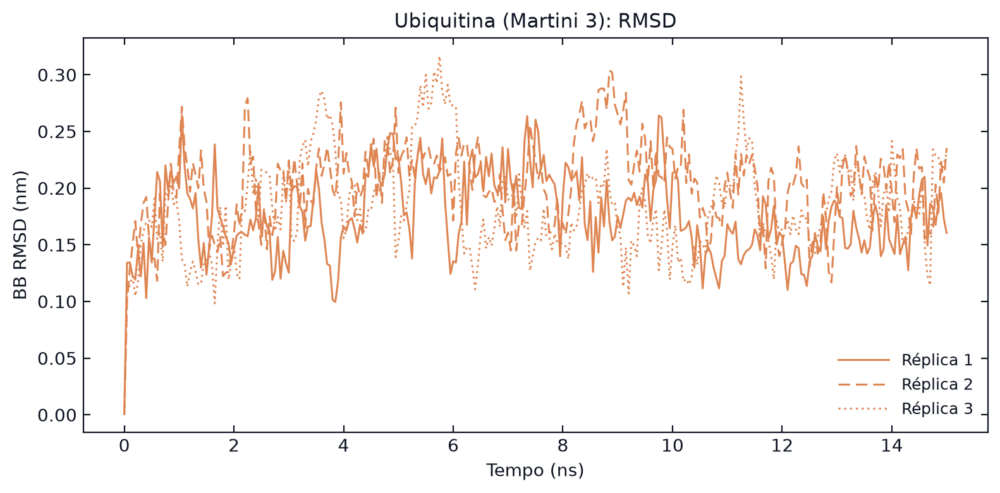

Com réplicas que concordam, a faixa de desvio é estreita e a média representa bem o sistema.

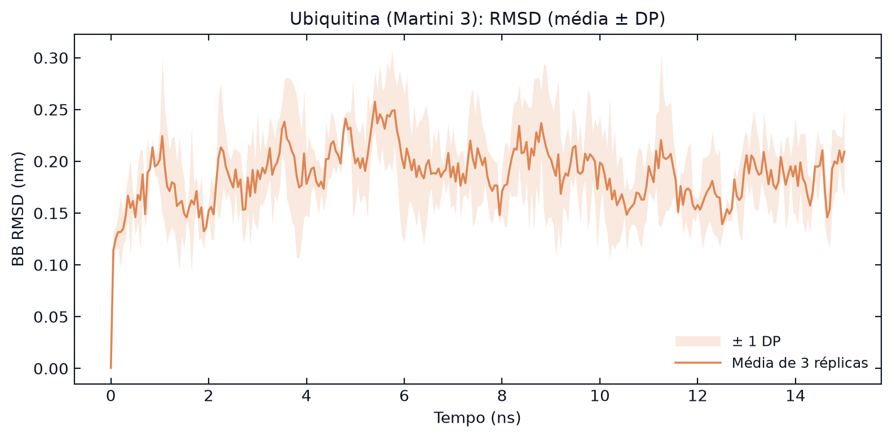

**Proteína: RMSF.** Os picos caem nos mesmos resíduos nas três réplicas: perto do 9, em 46-47 e na cauda C-terminal. A flexibilidade de cada região é propriedade da proteína, não de uma corrida. A cauda C-terminal termina na Gly76, o ponto em que a ubiquitina se liga a outras proteínas; a faixa cinza é a α-hélice, uma das regiões mais rígidas.

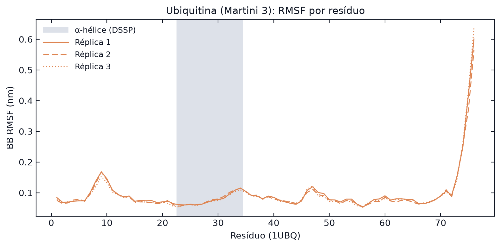

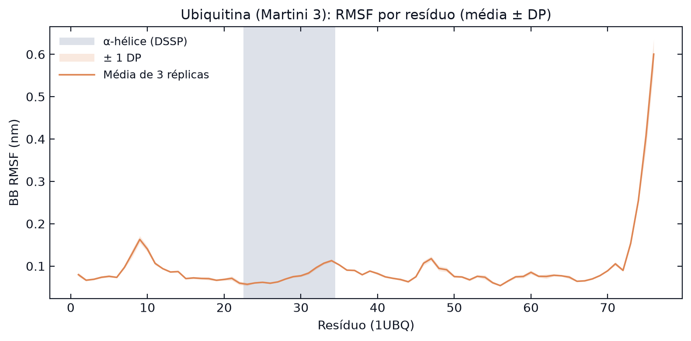

**Membrana: parâmetro de ordem.** Em duas réplicas o S sobe de ~0,2 para ~0,7 entre 4 e 7 ns; na terceira fica perto de 0,2 e só começa a subir no fim. A formação da bicamada é um evento cinético: o destino é o mesmo, mas o tempo depende da semente.

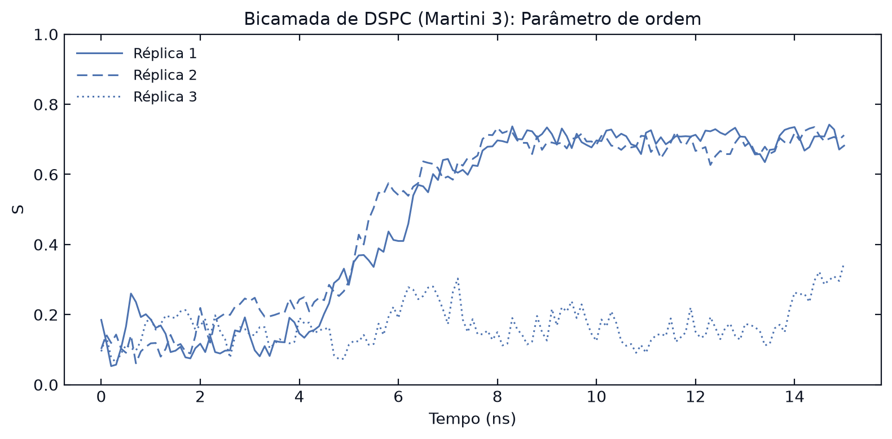

Depois de 6 ns a faixa de desvio fica larga e a média para em ~0,5, um valor que nenhuma réplica tem. A média esconde que duas formaram a bicamada e uma não: olhe sempre as réplicas antes de confiar na média.

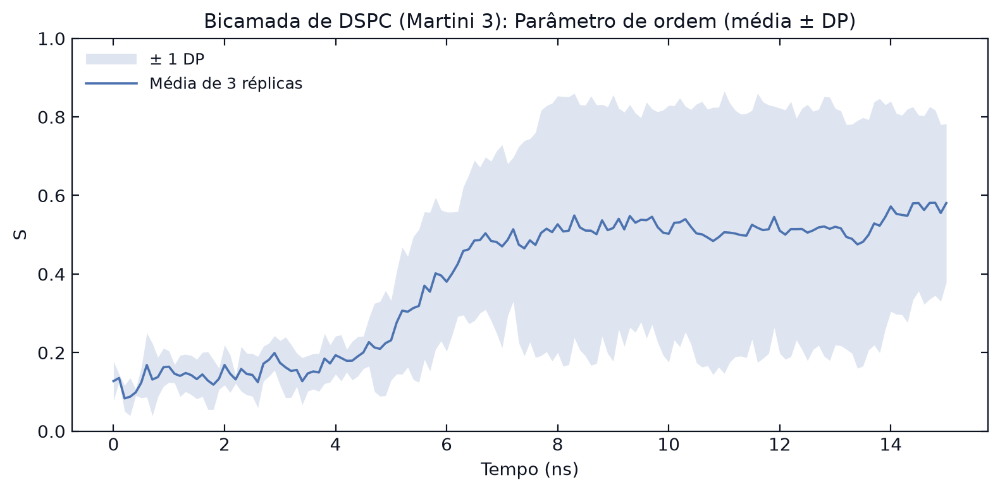

**Membrana: energia potencial.** A energia cai nas três réplicas, porque as caudas apolares deixam de tocar a água. A réplica sem bicamada termina um pouco acima: a bicamada é o vale mais fundo da paisagem.

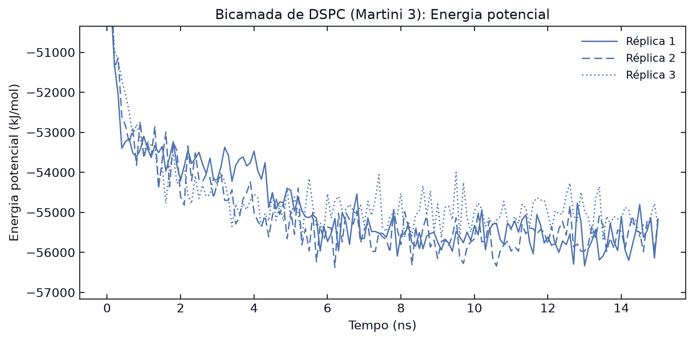

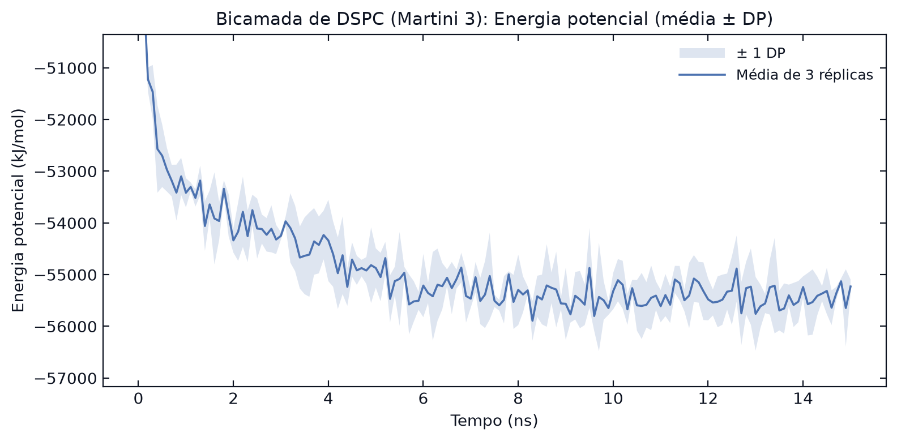

**Membrana: valores finais**, só das réplicas em que a bicamada se formou. Com duas réplicas, o desvio padrão é uma estimativa grosseira; um valor confiável pede mais réplicas.

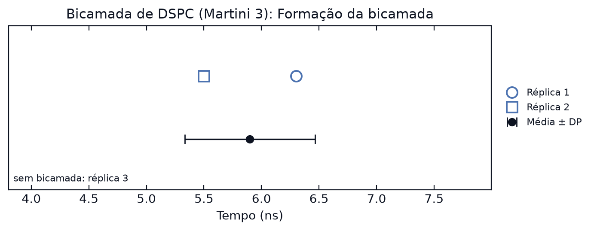

A espessura entre os planos de fosfato fica perto de 4,3 nm, da ordem das membranas das células.

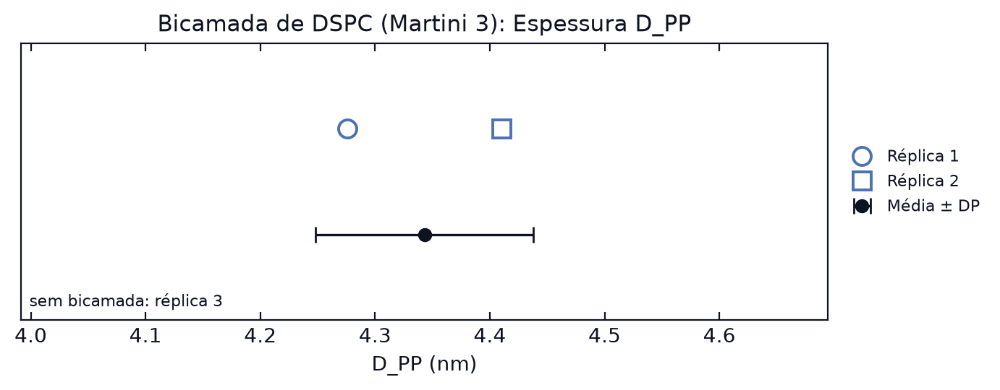

A área por lipídio fica perto de 0,60 nm². Quanto maior a área, mais fluida e permeável a membrana; colesterol e caudas saturadas diminuem a área, caudas insaturadas aumentam.

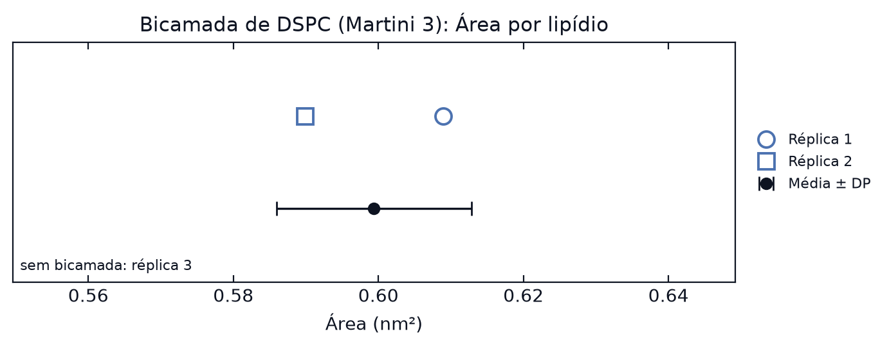

Uso em aula: cada grupo escolhe uma `REPLICA`, com `USE_PRECOMPUTED = True` para ver os resultados na hora ou `False` para simular a própria réplica.


## Material legado: curso atomístico

Versão anterior do curso, em resolução all-atom, mantida em `legado/`.

| Arquivo | Conteúdo | Colab |
|---------|----------|-------|
| `legado/MD_GMX.ipynb` | ubiquitina (1UBQ) em água, CHARMM36m; Exercício 1 de Lemkul (2024) | <a href="https://colab.research.google.com/github/madsondeluna/curso-dinamica-molecular-202x/blob/main/legado/MD_GMX.ipynb" target="_blank"></a> |
| `legado/mdp/` | `ions.mdp`, `minim.mdp`, `nvt.mdp`, `npt.mdp`, `md.mdp` (CHARMM36m) | |
| `legado/lemkul-2024-...pdf` | artigo de referência | |

O campo de força CHARMM36m (julho 2022) é baixado pelo notebook. Cópias do notebook salvas antes da mudança para `legado/` buscam os `.mdp` no caminho antigo; abra a versão pelo botão acima.

| Etapa | Comando principal | Valor no notebook | Valor no artigo |
|-------|-------------------|-------------------|-----------------|
| Topologia | `gmx pdb2gmx -water tip3p` | CHARMM36m | CHARMM36m |
| Caixa | `gmx editconf -c -d 1.2 -bt cubic` | 1,2 nm | 1,2 nm |
| Solvatação | `gmx solvate -cs spc216.gro` | TIP3P | TIP3P |
| Íons | `gmx genion -conc` | 0,1 M NaCl | 0,1 M NaCl |
| Minimização | `gmx mdrun` (steep) | `emtol = 500` | `emtol = 500` |
| NVT | `nvt.mdp` | 20 ps, 298 K | 100 ps |
| NPT | `npt.mdp`, C-rescale | 50 ps, 1 bar | 500 ps |
| Produção | `md.mdp` | 100 ps | 50 + 50 ns |
| Análises | `gmx rms`, `rmsf`, `gyrate`, `mdmat`, `hbond`; DSSP via MDTraj | RMSD, RMSF, Rg, contatos, ligações H, DSSP | RMSD, RMSF, ligações H, DSSP |

Parâmetros obrigatórios do CHARMM36m, presentes em todos os arquivos de `legado/mdp/`:

```
vdw-modifier    = force-switch
rvdw-switch     = 1.0
rvdw            = 1.2
rcoulomb        = 1.2
rlist           = 1.4
dispcorr        = no
constraints     = h-bonds
```


## Referência técnica

### Estrutura do repositório

| Caminho | Conteúdo |
|---------|----------|
| `MD_Martini.ipynb` | notebook coarse-grained (gerado por `tools/build_martini_notebook.py`) |
| `legado/` | curso atomístico anterior: `MD_GMX.ipynb`, `mdp/`, artigo de Lemkul (2024) |
| `mdp_martini/` | `minim.mdp`, `ions.mdp`, `npt_prot.mdp`, `md_prot.mdp`, `md_membrane.mdp`, `md_membrane_eq.mdp` |
| `viz/stage_viewer.py`, `viz/stage.css`, `viz/pure/` | cartões de etapa e tema dos gráficos |
| `viz/replica_plots.py` | gráficos de réplicas e de média ± DP |
| `viz/replica_views.py` | visualizadores 3D das réplicas (bastões nas ligações CG, cores do `vmd_view.sh` do AMP-evo-MD) |
| `results/repN.tar.gz` | as três réplicas simuladas, todas as etapas |
| `results/summary_repN.json` | séries e valores finais de cada réplica |
| `results/viz/repN_*.pdb` | estruturas e animações com ligações CG para os visualizadores 3D |
| `results/pack_results.sh` | empacota e anonimiza as réplicas |
| `imagens/fund_*.png` | ilustrações dos fundamentos (`tools/make_figures.py`) |
| `imagens/martini_*.png` | réplicas: um gráfico por métrica, valores finais e vistas ortográficas (`tools/make_replica_figures.py`) |
| `tools/run_replicas.sh` | roda as três réplicas localmente (`runs/`, fora do git) |

### Parâmetros Martini 3 (todos os `.mdp` de `mdp_martini/`)

```
cutoff-scheme            = Verlet
verlet-buffer-tolerance  = 0.005
coulombtype              = reaction-field
rcoulomb                 = 1.1
epsilon_r                = 15
epsilon_rf               = 0
vdw_type                 = cutoff
vdw-modifier             = Potential-shift-verlet
rvdw                     = 1.1
```

| Item | Fonte |
|------|-------|
| `vermouth` (martinize2), `mdtraj`, `py3Dmol` | `pip`, instalados pelo notebook |
| `martini_v3.0.0.itp`, `_ffbonded_v2.itp`, `_phospholipids_PC_v2.itp`, `_solvents_v1.itp`, `_ions_v1.itp` | [M3-Lipid-Parameters](https://github.com/Martini-Force-Field-Initiative/M3-Lipid-Parameters) |
| `water.gro` (400 W), `DPPC-em.gro` (1 lipídio) | biblioteca [cgmartini.nl](https://cgmartini.nl) |

### Tipos de arquivos GROMACS

| Extensão | Conteúdo |
|----------|----------|
| `.gro` | coordenadas (nm) |
| `.pdb` | coordenadas no formato do Protein Data Bank (Å) |
| `.top` | topologia completa do sistema |
| `.itp` | topologia incluída: um tipo de molécula ou parâmetros auxiliares |
| `.mdp` | parâmetros da simulação |
| `.tpr` | entrada binária do `mdrun` |
| `.edr` | energias |
| `.xtc` | trajetória comprimida |
| `.trr` | trajetória de alta precisão |
| `.cpt` | checkpoint para retomar a simulação |
| `.ndx` | grupos de índice |
| `.xvg` | séries de dados das ferramentas de análise |

### Possíveis erros e soluções

| Erro | Causa | Solução |
|------|-------|---------|
| `number of coordinates in coordinate file does not match topology` | `.gro` e `.top` dessincronizados | refaça a etapa que adicionou ou removeu moléculas com `-p topol.top` |
| LINCS warnings, `Water molecule cannot be settled` | geometria ruim ou `dt` grande | confira a minimização; no all-atom, reduza `dt` para 0,001 |
| `pdb2gmx` não reconhece átomos | nomenclatura não padrão | use `-ignh` |
| Molécula quebrada na visualização | condições periódicas | `gmx trjconv -pbc mol -center -ur compact` |
| `-nb gpu` falha | sem GPU | remova a flag; `gmx mdrun -ntmpi 1` |
| Martini: minimização não converge a 100 kJ/mol/nm | rede elástica e geometria fixa das cadeias laterais | use `emtol = 1000` |
| Martini: concentração de íons quatro vezes menor | `genion -conc` conta 1 W como 1 molécula | calcule `-np` e `-nn` pelo volume |
| Martini: bicamada não se forma | formação não é garantida no tempo simulado | estenda com `gmx convert-tpr -s mem_md.tpr -extend 15000 -o mem_md.tpr`, apague `mem_md.gro` e execute B2; ou apague `mem_noW.gro` e `mem_*` para nova configuração |
| Célula pula uma etapa que deveria rodar | arquivo final de uma execução anterior na pasta | apague os arquivos da etapa ou use outra pasta de trabalho |


## Referências

- Lemkul, J. A. Introductory Tutorials for Simulating Protein Dynamics with GROMACS. *J. Phys. Chem. B* **2024**, *128*, 9418-9435. https://doi.org/10.1021/acs.jpcb.4c04901
- Souza, P. C. T. *et al.* Martini 3: a general purpose force field for coarse-grained molecular dynamics. *Nat. Methods* **2021**, *18*, 382-388. https://doi.org/10.1038/s41592-021-01098-3
- Kroon, P. C. *et al.* Martinize2 and Vermouth provide a unified framework for molecular topology generation. *eLife* **2025**, *12*, RP90627. https://doi.org/10.7554/eLife.90627
- Pedersen, K. B. *et al.* The Martini 3 lipidome: expanded and refined parameters improve lipid phase behavior. *ACS Cent. Sci.* **2025**, *11*, 1598-1610. https://doi.org/10.1021/acscentsci.5c00755
- Marrink, S. J.; Risselada, H. J.; Yefimov, S.; Tieleman, D. P.; de Vries, A. H. The MARTINI force field: coarse grained model for biomolecular simulations. *J. Phys. Chem. B* **2007**, *111*, 7812-7824. https://doi.org/10.1021/jp071097f
- Marrink, S. J.; Lindahl, E.; Edholm, O.; Mark, A. E. Simulation of the spontaneous aggregation of phospholipids into bilayers. *J. Am. Chem. Soc.* **2001**, *123*, 8638-8639. https://doi.org/10.1021/ja0159618
- McGibbon, R. T. *et al.* MDTraj: a modern open library for the analysis of molecular dynamics trajectories. *Biophys. J.* **2015**, *109*, 1528-1532. https://doi.org/10.1016/j.bpj.2015.08.015
- van Meer, G.; Voelker, D. R.; Feigenson, G. W. Membrane lipids: where they are and how they behave. *Nat. Rev. Mol. Cell Biol.* **2008**, *9*, 112-124. https://doi.org/10.1038/nrm2330
- Utsugi, T.; Schroit, A. J.; Connor, J.; Bucana, C. D.; Fidler, I. J. Elevated expression of phosphatidylserine in the outer membrane leaflet of human tumor cells and recognition by activated human blood monocytes. *Cancer Res.* **1991**, *51*, 3062-3066. PMID 2032247
- Sohlenkamp, C.; Geiger, O. Bacterial membrane lipids: diversity in structures and pathways. *FEMS Microbiol. Rev.* **2016**, *40*, 133-159. https://doi.org/10.1093/femsre/fuv008
- Zasloff, M. Antimicrobial peptides of multicellular organisms. *Nature* **2002**, *415*, 389-395. https://doi.org/10.1038/415389a
- Simons, K.; Ikonen, E. Functional rafts in cell membranes. *Nature* **1997**, *387*, 569-572. https://doi.org/10.1038/42408
- Lingwood, D.; Simons, K. Lipid rafts as a membrane-organizing principle. *Science* **2010**, *327*, 46-50. https://doi.org/10.1126/science.1174621
- Vona, R.; Iessi, E.; Matarrese, P. Role of cholesterol and lipid rafts in cancer signaling: a promising therapeutic opportunity? *Front. Cell Dev. Biol.* **2021**, *9*, 622908. https://doi.org/10.3389/fcell.2021.622908
- Risselada, H. J.; Marrink, S. J. The molecular face of lipid rafts in model membranes. *Proc. Natl. Acad. Sci. USA* **2008**, *105*, 17367-17372. https://doi.org/10.1073/pnas.0807527105
- Dennis, E. A.; Norris, P. C. Eicosanoid storm in infection and inflammation. *Nat. Rev. Immunol.* **2015**, *15*, 511-523. https://doi.org/10.1038/nri3859
- Rysman, E. *et al.* De novo lipogenesis protects cancer cells from free radicals and chemotherapeutics by promoting membrane lipid saturation. *Cancer Res.* **2010**, *70*, 8117-8126. https://doi.org/10.1158/0008-5472.CAN-09-3871
- Kagan, V. E. *et al.* Oxidized arachidonic and adrenic PEs navigate cells to ferroptosis. *Nat. Chem. Biol.* **2017**, *13*, 81-90. https://doi.org/10.1038/nchembio.2238
- Krogh, A.; Larsson, B.; von Heijne, G.; Sonnhammer, E. L. Predicting transmembrane protein topology with a hidden Markov model: application to complete genomes. *J. Mol. Biol.* **2001**, *305*, 567-580. https://doi.org/10.1006/jmbi.2000.4315
- Hauser, A. S. *et al.* Trends in GPCR drug discovery: new agents, targets and indications. *Nat. Rev. Drug Discov.* **2017**, *16*, 829-842. https://doi.org/10.1038/nrd.2017.178
- Gottesman, M. M.; Fojo, T.; Bates, S. E. Multidrug resistance in cancer: role of ATP-dependent transporters. *Nat. Rev. Cancer* **2002**, *2*, 48-58. https://doi.org/10.1038/nrc706
- Corradi, V. *et al.* Lipid-protein interactions are unique fingerprints for membrane proteins. *ACS Cent. Sci.* **2018**, *4*, 709-717. https://doi.org/10.1021/acscentsci.8b00143
- Brogden, K. A. Antimicrobial peptides: pore formers or metabolic inhibitors in bacteria? *Nat. Rev. Microbiol.* **2005**, *3*, 238-250. https://doi.org/10.1038/nrmicro1098
- Shai, Y. Mode of action of membrane active antimicrobial peptides. *Biopolymers* **2002**, *66*, 236-248. https://doi.org/10.1002/bip.10260
- Bross, P. F. *et al.* Approval summary for bortezomib for injection in the treatment of multiple myeloma. *Clin. Cancer Res.* **2004**, *10*, 3954-3964. https://doi.org/10.1158/1078-0432.CCR-03-0781
- Tutorial Martini 3, *Lipid bilayers, Part I: Self-assembly*: https://cgmartini.nl/docs/tutorials/Martini3/LipidsI/
- Inputs do tutorial de Lemkul: https://github.com/Lemkul-Lab/gmx_tutorials_jpcb
- Manual do GROMACS: https://manual.gromacs.org/


## Autoria

| | |
|---|---|
| Autor | **Madson A. de Luna-Aragão**, MSc |
| Vínculos | Programa Interunidades de Pós-Graduação em Bioinformática, Universidade Federal de Minas Gerais (UFMG), Belo Horizonte, Brasil<br>CNRS, Institut de Biologie et Chimie des Protéines (IBCP), Lyon, França |
| E-mail | [madsondeluna@gmail.com](mailto:madsondeluna@gmail.com) |
| Site | [madsondeluna.com](https://madsondeluna.com) |
| GitHub | [github.com/madsondeluna](https://github.com/madsondeluna) |
| LinkedIn | [linkedin.com/in/madsonaragao](https://www.linkedin.com/in/madsonaragao/) |
| Repositório | [madsondeluna/curso-dinamica-molecular-202x](https://github.com/madsondeluna/curso-dinamica-molecular-202x) |

## Licença

[MIT License](LICENSE).
