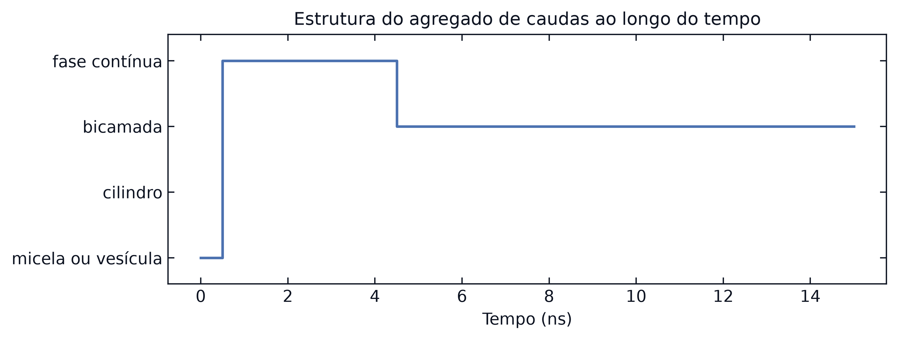
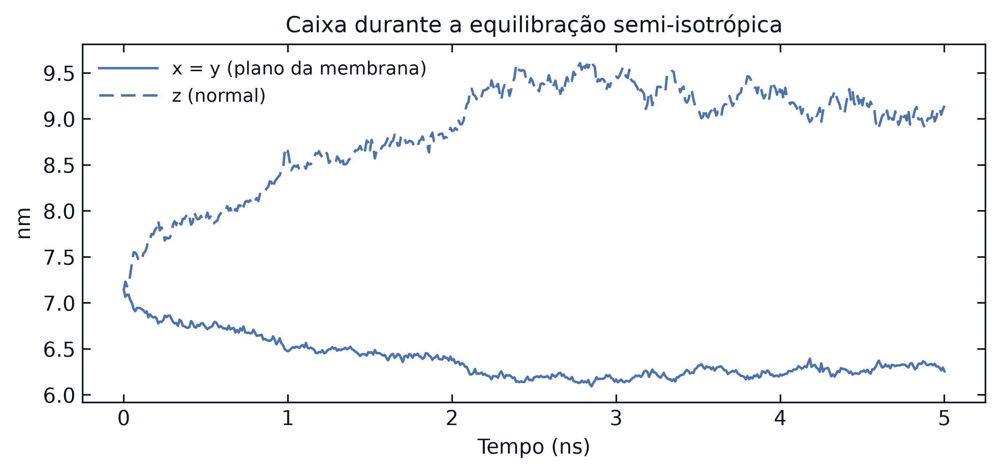
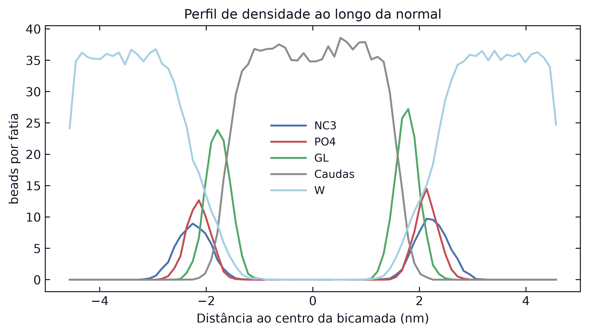

# Passo a passo: automontagem de uma bicamada de DSPC em Martini 3

Roteiro completo para montar a caixa, simular a automontagem, equilibrar e analisar uma bicamada de DSPC em Martini 3, com os mesmos comandos que o notebook `MD_Martini.ipynb` executa. A composição segue o tutorial oficial *Lipid bilayers, Part I: Self-assembly* do Martini 3, com o dobro de água. Os valores de referência são da réplica 1 deste repositório.

[Voltar ao README](../README.md) · [Passo a passo da proteína](proteina.md)

## Programas

| Programa | Versão usada | Para quê |
|----------|--------------|----------|
| GROMACS | 2021.4 (Colab, `apt`) e 2025.3 (réplicas locais) | montagem da caixa, minimização, dinâmica |
| MDTraj | 1.11 | leitura da trajetória em Python |
| Python 3 com NumPy e Matplotlib | 3.12 | parâmetro de ordem, percolação, perfil de densidade, gráficos |

```bash
pip install mdtraj numpy matplotlib
# GROMACS: sudo apt install gromacs (Ubuntu), brew install gromacs (macOS)
# ou conda install -c conda-forge gromacs
```

## Arquivos de entrada

| Arquivo | Origem | Conteúdo |
|---------|--------|----------|
| `DPPC-em.gro` | [biblioteca Martini](https://cgmartini-library.s3.ca-central-1.amazonaws.com/1_Downloads/ff_parameters/martini2/lipidome/pc/dppc/DPPC-em.gro) | um lipídio minimizado, usado como molde |
| `martini_v3.0.0.itp`, `martini_v3.0.0_ffbonded_v2.itp`, `martini_v3.0.0_phospholipids_PC_v2.itp`, `martini_v3.0.0_solvents_v1.itp` | [M3-Lipid-Parameters](https://github.com/Martini-Force-Field-Initiative/M3-Lipid-Parameters/tree/main/ITPs) | tipos de bead, parâmetros ligados, fosfatidilcolinas (inclui DSPC), água W |
| `water.gro` | [biblioteca Martini](https://cgmartini-library.s3.ca-central-1.amazonaws.com/1_Downloads/example_applications/solvent_systems/water.gro) | caixa de água W equilibrada |
| `minim.mdp`, `md_membrane.mdp`, `md_membrane_eq.mdp` | [`mdp_martini/`](../mdp_martini) | parâmetros de cada etapa |

## 1. Um lipídio de DSPC

```bash
wget https://cgmartini-library.s3.ca-central-1.amazonaws.com/1_Downloads/ff_parameters/martini2/lipidome/pc/dppc/DPPC-em.gro -O DSPC-em.gro
sed -i 's/DPPC/DSPC/' DSPC-em.gro        # no macOS: sed -i '' 's/DPPC/DSPC/' DSPC-em.gro
```

O DSPC do Martini 3 tem os mesmos 12 beads e os mesmos nomes do molde: colina (NC3), fosfato (PO4), dois gliceróis (GL1, GL2) e quatro beads por cauda (C1A a C4A, C1B a C4B). Trocar o nome do resíduo basta para o `grompp` aplicar os parâmetros do DSPC.

## 2. Topologia

Crie `dspc.top`:

```
#include "martini_v3.0.0.itp"
#include "martini_v3.0.0_ffbonded_v2.itp"
#include "martini_v3.0.0_phospholipids_PC_v2.itp"
#include "martini_v3.0.0_solvents_v1.itp"

[ system ]
DSPC bilayer self-assembly

[ molecules ]
DSPC   128
W      1536
```

## 3. Lipídios em posições aleatórias

```bash
gmx insert-molecules -ci DSPC-em.gro -box 7.5 7.5 7.5 -nmol 128 -radius 0.21 -try 500 -seed 12345 -o mem_noW.gro
```

| Opção | Efeito |
|-------|--------|
| `-box 7.5 7.5 7.5` | caixa cúbica de 7,5 nm |
| `-nmol 128` | 128 cópias, cada uma com posição e orientação sorteadas |
| `-radius 0.21`, `-try 500` | rejeita cópias que se sobrepõem; até 500 tentativas por lipídio |
| `-seed` | semente do sorteio; o notebook sorteia uma e grava em `seeds.json` |

Confira na saída `Added 128 molecules`. Não há bicamada, micela nem qualquer ordem: é o estado inicial.

## 4. Água

```bash
gmx solvate -cp mem_noW.gro -cs water.gro -o mem_solv.gro -maxsol 1536 -radius 0.21
```

`-maxsol 1536` coloca exatamente 1 536 beads W, 12 por lipídio (48 moléculas de água por lipídio). O número é fixo para bater com `dspc.top`; o `solvate` não edita a topologia aqui. Sistema: 128 × 12 + 1 536 = 3 072 beads.

## 5. Minimização

```bash
gmx grompp -f minim.mdp -c mem_solv.gro -p dspc.top -o mem_em.tpr
gmx mdrun -deffnm mem_em
```

Mesmos parâmetros da proteína: descida mais íngreme até `Fmax < 1000` kJ mol⁻¹ nm⁻¹, reaction-field com `epsilon_r = 15` e corte de 1,1 nm.

## 6. Automontagem

```bash
gmx grompp -f md_membrane.mdp -c mem_em.gro -p dspc.top -o mem_md.tpr
gmx mdrun -deffnm mem_md -cpi mem_md.cpt -cpt 5
```

| Parâmetro | Valor | Por quê |
|-----------|-------|---------|
| `dt`, `nsteps` | 20 fs, 750 000 (15 ns) | |
| `ref_t`, `tc-grps` | 340 K, `DSPC W` | acima da transição gel-fluido do DSPC (cerca de 328 K); lipídios e água em grupos de termostato separados |
| `pcoupltype` | `isotropic` | ainda não há bicamada, logo não há direção normal |
| `tau_p`, `compressibility` | 4 ps, 3 × 10⁻⁴ bar⁻¹ | |
| `gen_vel`, `gen_seed` | `yes`, −1 | velocidades sorteadas; semente registrada na saída do `grompp` |

Tempo medido: 8 a 9 min em 6 threads de um Apple M2. Para os passos seguintes, gere uma trajetória com cada molécula inteira e a energia:

```bash
echo System    | gmx trjconv -s mem_md.tpr -f mem_md.xtc -o mem_whole.xtc -pbc mol
echo Potential | gmx energy  -f mem_md.edr -o mem_potential.xvg
```


## 7. Parâmetro de ordem

O vetor de cada lipídio vai do PO4 ao ponto médio das duas pontas das caudas (C4A e C4B). O tensor de ordem $Q = \langle \tfrac{3}{2}\hat{u}\hat{u}^T - \tfrac{1}{2}I \rangle$ é a média sobre os lipídios; seu maior autovalor é $S$ e o autovetor correspondente é a normal da bicamada.

```python
import mdtraj as md, numpy as np

traj = md.load('mem_whole.xtc', top='mem_em.gro')
top = traj.topology
po4, c4a, c4b = top.select('name PO4'), top.select('name C4A'), top.select('name C4B')
u = 0.5 * (traj.xyz[:, c4a] + traj.xyz[:, c4b]) - traj.xyz[:, po4]
u /= np.linalg.norm(u, axis=2, keepdims=True)
Q = 1.5 * np.einsum('fli,flj->fij', u, u) / u.shape[1] - 0.5 * np.eye(3)
evals, evecs = np.linalg.eigh(Q)
S, normal = evals[:, -1], evecs[-1, :, -1]
t_ns = traj.time / 1000
print('S inicial', S[0].round(2), 'S final', S[-1].round(2), 'normal', normal.round(2))
```

$S$ perto de 0,2 indica orientações ao acaso; perto de 0,7, lipídios alinhados numa bicamada. Réplica 1: $S$ final 0,68 e normal ao longo de x.


## 8. Que estrutura se formou: percolação

$S$ alto não distingue uma bicamada de outras fases ordenadas. A dimensionalidade de percolação conta em quantas direções independentes o agregado de caudas se fecha sobre si mesmo através das imagens periódicas: 0 micela ou vesícula, 1 cilindro, 2 bicamada, 3 fase contínua. Dois beads de cauda (`C1A` a `C4B`) são vizinhos quando estão a menos de 0,6 nm, contando a imagem periódica mais próxima. O agregado é percorrido vizinho a vizinho; cada vez que ele reencontra um bead numa cópia diferente da caixa, o deslocamento entre as cópias entra numa lista, e o posto dessa lista é a dimensão. A função `percolation` do notebook implementa o algoritmo.

Critério de bicamada formada: dimensão 2 **e** $S$ final > 0,5. Réplica 1: fase contínua a partir de 1 ns, bicamada entre 4 e 5 ns, critério completo cumprido em 6,3 ns.



## 9. Equilibração semi-isotrópica

Com acoplamento isotrópico, a caixa só muda de tamanho mantendo a forma cúbica, e a área da membrana fica presa a essa forma. Na equilibração semi-isotrópica, o plano da membrana e a normal são acoplados separadamente. O GROMACS trata z como a normal, então antes os eixos do `.gro` são permutados para que a normal da bicamada (calculada no passo 7) caia em z. O notebook faz isso com a função `rotate_gro`, que permuta posições, velocidades e caixa de forma cíclica (uma rotação própria, que preserva a quiralidade).

```bash
gmx grompp -f md_membrane_eq.mdp -c mem_rot.gro -p dspc.top -o mem_eq.tpr
gmx mdrun -deffnm mem_eq -cpi mem_eq.cpt -cpt 5
echo System | gmx trjconv -s mem_eq.tpr -f mem_eq.xtc -o mem_eq_whole.xtc -pbc mol
printf "Box-X\nBox-Z\n" | gmx energy -f mem_eq.edr -o mem_eq_box.xvg
```

| Parâmetro | Valor |
|-----------|-------|
| `pcoupltype` | `semiisotropic` (xy e z acoplados separadamente) |
| `compressibility`, `ref_p` | 3 × 10⁻⁴ 3 × 10⁻⁴ bar⁻¹, 1 1 bar |
| `nsteps` | 250 000 (5 ns) |
| `continuation`, `gen_vel` | `yes`, `no`: continua com as velocidades do fim da automontagem |

Réplica 1: o lado da caixa no plano cai de 7,14 para 6,26 nm e a normal cresce de 7,14 para 9,14 nm.



## 10. Perfil de densidade, espessura e área por lipídio

Usando a segunda metade da equilibração: as posições ao longo de z são centradas no meio da bicamada (média circular das caudas, que não se confunde com a borda periódica) e viram histogramas por tipo de bead.

```python
teq = md.load('mem_eq_whole.xtc', top='mem_rot.gro')
last = teq[teq.n_frames // 2:]
tq = last.topology
po4, tails = tq.select('name PO4'), tq.select('name =~ "C[1-4][AB]"')
Lz, z = last.unitcell_lengths[:, 2], last.xyz[:, :, 2]
ang = 2 * np.pi * z[:, tails] / Lz[:, None]
center = np.arctan2(np.sin(ang).mean(1), np.cos(ang).mean(1)) / (2 * np.pi) * Lz
zc = (z - center[:, None] + Lz[:, None] / 2) % Lz[:, None] - Lz[:, None] / 2
bins = np.linspace(-Lz.mean() / 2, Lz.mean() / 2, 81); mid = 0.5 * (bins[1:] + bins[:-1])
h, _ = np.histogram(zc[:, po4].ravel(), bins=bins)
D_PP = mid[mid > 0][np.argmax(h[mid > 0])] - mid[mid < 0][np.argmax(h[mid < 0])]
APL = (last.unitcell_lengths[:, 0] * last.unitcell_lengths[:, 1]).mean() / (len(po4) / 2)
print(f'D_PP = {D_PP:.2f} nm; área por lipídio = {APL:.3f} nm²')
```

| Medida | Definição | Réplica 1 | Réplica 2 |
|--------|-----------|-----------|-----------|
| Espessura $D_{PP}$ | distância entre os picos de PO4 das duas monocamadas | 4,28 nm | 4,41 nm |
| Área por lipídio | área do plano xy ÷ metade dos lipídios (64) | 0,609 nm² | 0,590 nm² |



A réplica 3 não formou bicamada em 15 ns e fica de fora dessas medidas: a seção de réplicas do README discute o caso.

## Resumo dos arquivos

| Etapa | Entrada | Saída |
|-------|---------|-------|
| 1 | `DPPC-em.gro` | `DSPC-em.gro` |
| 3 | `DSPC-em.gro` | `mem_noW.gro` |
| 4 | `mem_noW.gro`, `water.gro` | `mem_solv.gro` |
| 5 | `mem_solv.gro`, `minim.mdp` | `mem_em.gro` |
| 6 | `mem_em.gro`, `md_membrane.mdp` | `mem_md.xtc`, `mem_md.edr`, `mem_md.gro`, `mem_whole.xtc` |
| 7 e 8 | `mem_whole.xtc` | $S(t)$, normal, dimensão de percolação |
| 9 | `mem_md.gro` girado (`mem_rot.gro`), `md_membrane_eq.mdp` | `mem_eq.xtc`, `mem_eq_whole.xtc`, `mem_eq_box.xvg` |
| 10 | `mem_eq_whole.xtc` | perfil de densidade, $D_{PP}$, área por lipídio |
