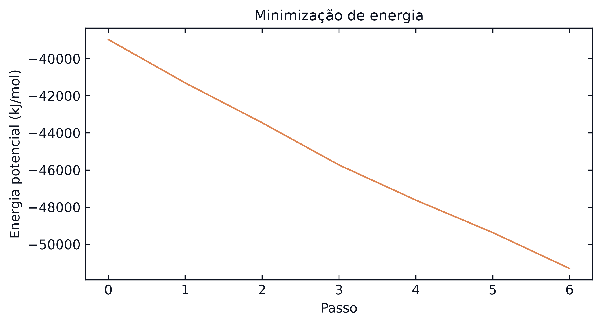
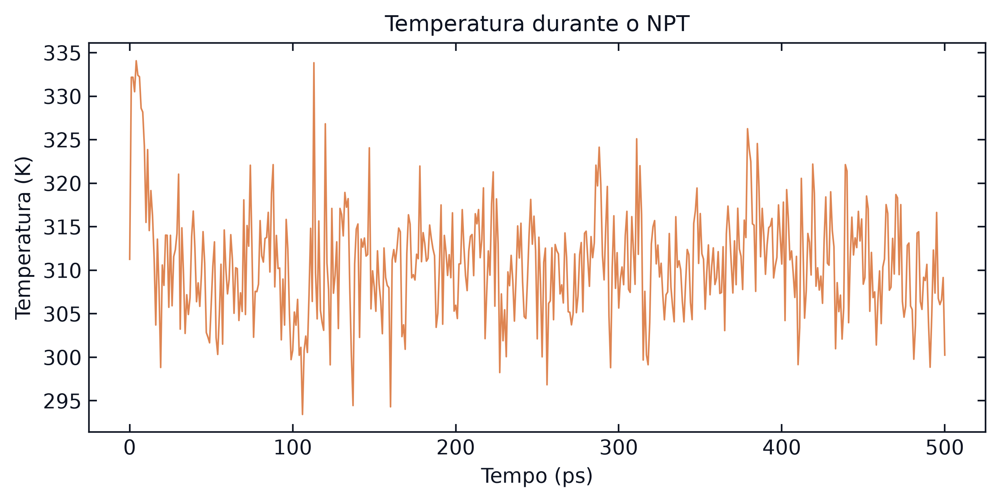
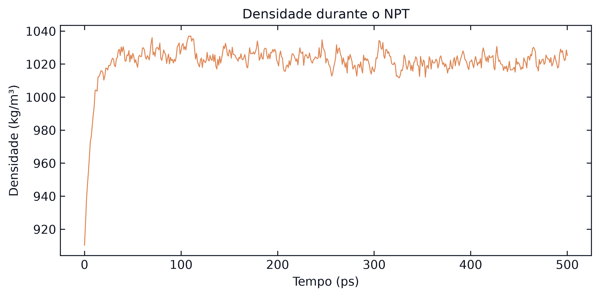
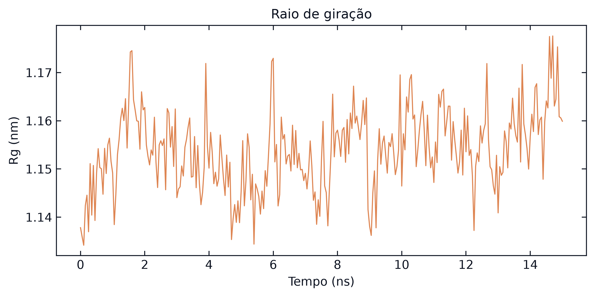
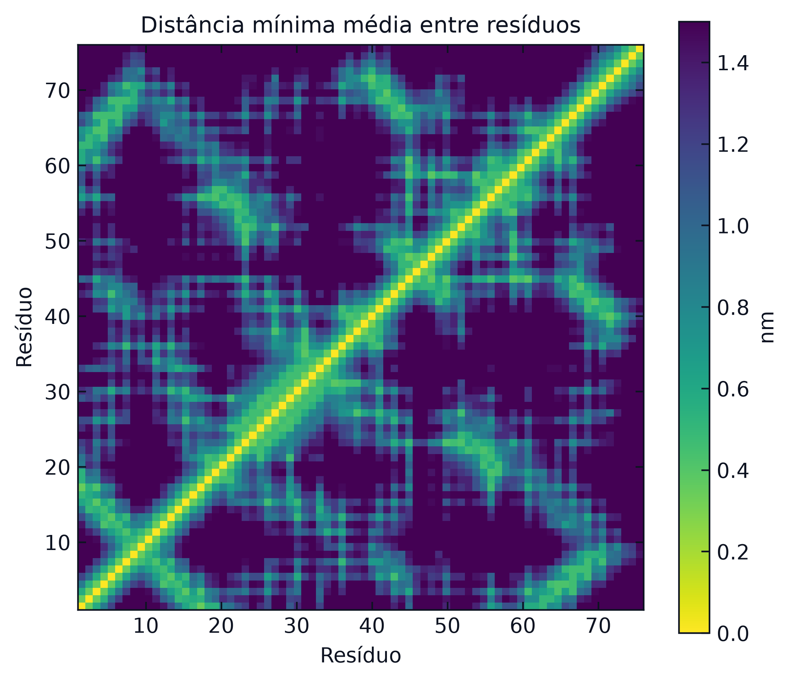

# Passo a passo: ubiquitina em Martini 3

Roteiro completo para montar, simular e analisar a ubiquitina (PDB 1UBQ) em água com o campo de força coarse-grained Martini 3, com os mesmos comandos que o notebook `MD_Martini.ipynb` executa. Os valores de referência são da réplica 1 deste repositório.

[Voltar ao README](../README.md) · [Passo a passo da membrana](membrana.md)

## Programas

| Programa | Versão usada | Para quê |
|----------|--------------|----------|
| GROMACS | 2021.4 (Colab, `apt`) e 2025.3 (réplicas locais) | preparo da caixa, minimização, dinâmica e análises |
| martinize2 (pacote `vermouth`) | 0.15.0 | conversão da estrutura atomística em beads Martini 3 e topologia da proteína |
| MDTraj | 1.11 | DSSP chamado pelo martinize2 e leitura de trajetórias em Python |
| Python 3 com NumPy e Matplotlib | 3.12 | leitura dos `.xvg` e gráficos |

```bash
pip install vermouth mdtraj numpy matplotlib
# GROMACS: sudo apt install gromacs (Ubuntu), brew install gromacs (macOS)
# ou conda install -c conda-forge gromacs
```

Vários comandos do GROMACS pedem que se escolha um grupo de átomos no teclado. Nos comandos abaixo, a escolha vai pelo `echo` ou `printf` antes do `|`: `printf "BB\nBB\n"` responde `BB` às duas perguntas.

## Arquivos de entrada

| Arquivo | Origem | Conteúdo |
|---------|--------|----------|
| `1UBQ.pdb` | [RCSB PDB](https://files.rcsb.org/download/1UBQ.pdb) | estrutura cristalográfica, 76 resíduos |
| `martini_v3.0.0.itp`, `martini_v3.0.0_solvents_v1.itp`, `martini_v3.0.0_ions_v1.itp` | [M3-Lipid-Parameters](https://github.com/Martini-Force-Field-Initiative/M3-Lipid-Parameters/tree/main/ITPs) | tipos de bead e interações, água W, íons |
| `water.gro` | [biblioteca Martini](https://cgmartini-library.s3.ca-central-1.amazonaws.com/1_Downloads/example_applications/solvent_systems/water.gro) | caixa de água W já equilibrada |
| `ions.mdp`, `minim.mdp`, `npt_prot.mdp`, `md_prot.mdp` | [`mdp_martini/`](../mdp_martini) | parâmetros de cada etapa |

## 1. Estrutura de partida

```bash
wget https://files.rcsb.org/download/1UBQ.pdb
grep '^ATOM' 1UBQ.pdb > 1UBQ_protein.pdb && echo END >> 1UBQ_protein.pdb
```

O `grep` mantém só as linhas `ATOM`, que são da proteína. As águas cristalográficas (`HETATM`) saem: o solvente será colocado depois, já em resolução Martini. O arquivo tem 602 átomos pesados; a cristalografia não resolve hidrogênios.

## 2. Conversão para beads: martinize2

```bash
martinize2 -f 1UBQ_protein.pdb -x ubq_cg.pdb -o martinize.top \
    -ff martini3001 -dssp -elastic -ef 700 -el 0.5 -eu 0.9 -cys auto -p backbone
```

| Opção | Efeito |
|-------|--------|
| `-f`, `-x`, `-o` | estrutura atomística de entrada, estrutura CG de saída, topologia de saída |
| `-ff martini3001` | campo de força Martini 3.0.0.1 |
| `-dssp` | calcula a estrutura secundária com o DSSP do MDTraj; ela define os parâmetros de ângulos e diedros do backbone |
| `-elastic` | liga beads BB próximos com molas (rede elástica) para manter a forma da proteína |
| `-ef 700` | constante das molas, em kJ mol⁻¹ nm⁻² |
| `-el 0.5`, `-eu 0.9` | só ganham mola os pares BB entre 0,5 e 0,9 nm |
| `-cys auto` | detecta pontes dissulfeto (a ubiquitina não tem) |
| `-p backbone` | escreve restrições de posição nos beads BB, ativadas depois por `-DPOSRES` |

Saídas: `ubq_cg.pdb` (166 beads), `molecule_0.itp` (topologia da proteína, com a estrutura secundária numa linha de comentário) e `martinize.top`. Para conferir a estrutura secundária (H hélice, E fita, C alça):

```bash
grep -A2 'secondary structure' molecule_0.itp
```

## 3. Topologia do sistema

Crie `topol.top`. A ordem dos `#include` importa: primeiro os tipos de bead, depois as moléculas.

```
#include "martini_v3.0.0.itp"
#include "molecule_0.itp"
#include "martini_v3.0.0_solvents_v1.itp"
#include "martini_v3.0.0_ions_v1.itp"

[ system ]
Ubiquitin Martini 3

[ molecules ]
molecule_0    1
```

As linhas de água e de íons em `[ molecules ]` são acrescentadas pelo `solvate` e pelo `genion`.

## 4. Caixa e solvatação

```bash
gmx editconf -f ubq_cg.pdb -o ubq_box.gro -c -d 1.2 -bt cubic
gmx solvate -cp ubq_box.gro -cs water.gro -radius 0.21 -o ubq_solv.gro -p topol.top
```

| Opção | Efeito |
|-------|--------|
| `-c -d 1.2 -bt cubic` | centra a proteína numa caixa cúbica com 1,2 nm entre a proteína e cada face |
| `-cs water.gro` | usa a caixa de água W como molde para preencher o volume |
| `-radius 0.21` | raio de exclusão: não coloca W a menos de 0,21 nm de um bead da proteína |

Cada bead W representa 4 moléculas de água. A caixa da réplica 1 tem 295,5 nm³.

## 5. Íons

O número de pares de NaCl para 0,15 M vem do volume da caixa: $N = 0{,}15 \times V \times 0{,}6022$, com $V$ em nm³. Para 295,5 nm³, $N = 27$. A opção `-conc` do `genion` não serve aqui: ela conta cada bead W como uma molécula de água e colocaria um quarto dos íons.

```bash
gmx grompp -f ions.mdp -c ubq_solv.gro -p topol.top -o ions.tpr
echo W | gmx genion -s ions.tpr -o ubq_ions.gro -p topol.top \
    -pname NA -nname CL -np 27 -nn 27 -neutral
```

O `genion` troca beads W por íons (`echo W` escolhe o grupo substituído) e atualiza `topol.top`. `-neutral` acerta a carga total; a ubiquitina tem carga líquida zero, então entram 27 Na⁺ e 27 Cl⁻.

## 6. Minimização de energia

```bash
gmx grompp -f minim.mdp -c ubq_ions.gro -p topol.top -o em.tpr
gmx mdrun -deffnm em
echo Potential | gmx energy -f em.edr -o em_potential.xvg
```

O `minim.mdp` usa descida mais íngreme (`integrator = steep`) até a força máxima ficar abaixo de `emtol = 1000` kJ mol⁻¹ nm⁻¹. Os parâmetros de interação são os padrões do Martini 3, os mesmos em todos os `.mdp`:

| Parâmetro | Valor | Significado |
|-----------|-------|-------------|
| `coulombtype` | `reaction-field` | eletrostática com corte e meio contínuo além dele |
| `epsilon_r` | 15 | blindagem dielétrica implícita |
| `rcoulomb`, `rvdw` | 1,1 nm | raio de corte |
| `vdw-modifier` | `Potential-shift-verlet` | potencial de Lennard-Jones vai a zero no corte |

O que conferir: a mensagem `converged to Fmax < 1000` no fim do `em.log` e energia potencial negativa. Réplica 1: de −38 971 para −51 305 kJ/mol em 6 passos.



## 7. Equilibração NPT com a proteína restrita

```bash
gmx grompp -f npt_prot.mdp -c em.gro -r em.gro -p topol.top -o npt.tpr
gmx mdrun -deffnm npt
printf "Temperature\nDensity\n" | gmx energy -f npt.edr -o npt_energy.xvg
```

| Parâmetro | Valor | Por que nesta etapa |
|-----------|-------|---------------------|
| `define` | `-DPOSRES -DPOSRES_FC=1000` | prende os beads BB (do `-p backbone`) enquanto água e íons se acomodam |
| `-r em.gro` | estrutura de referência das restrições | |
| `dt`, `nsteps` | 10 fs, 50 000 (0,5 ns) | passo menor enquanto o sistema relaxa |
| `tcoupl`, `ref_t` | `v-rescale`, 310 K | termostato; proteína e resto acoplados em grupos separados |
| `pcoupl`, `tau_p` | `c-rescale`, 12 ps | barostato a 1 bar, isotrópico |
| `gen_vel`, `gen_temp`, `gen_seed` | `yes`, 310, −1 | velocidades sorteadas; a semente é registrada no log do `grompp` |

O que conferir: temperatura em torno de 310 K (réplica 1: 310,8 ± 5,5 K na segunda metade) e densidade estável (de 910 para cerca de 1 021 kg/m³ em 50 ps).





## 8. Produção

```bash
gmx grompp -f md_prot.mdp -c npt.gro -t npt.cpt -p topol.top -o md_prot.tpr
gmx mdrun -deffnm md_prot -cpi md_prot.cpt -cpt 5
```

| Parâmetro | Valor |
|-----------|-------|
| `dt`, `nsteps` | 20 fs, 750 000 passos (15 ns) |
| `nstxout-compressed` | um quadro a cada 50 ps em `md_prot.xtc` |
| `continuation`, `gen_vel` | `yes`, `no`: continua das velocidades do NPT (`-t npt.cpt`) |
| restrições | nenhuma |

`-cpi md_prot.cpt -cpt 5` grava um checkpoint a cada 5 min e, se a corrida for interrompida, o mesmo comando continua de onde parou. Com GPU e um GROMACS com suporte, acrescente `-nb gpu`. Tempo medido: 14 a 31 min em 6 threads de um Apple M2.

## 9. Tratamento da trajetória

```bash
printf "a BB\nq\n" | gmx make_ndx -f md_prot.tpr -o index_prot.ndx
printf "Protein\nSystem\n" | gmx trjconv -s md_prot.tpr -f md_prot.xtc -n index_prot.ndx \
    -o md_prot_pbc.xtc -pbc mol -center -ur compact
printf "BB\nProtein\n" | gmx trjconv -s md_prot.tpr -f md_prot_pbc.xtc -n index_prot.ndx \
    -o md_prot_fit.xtc -fit rot+trans
```

| Comando | Efeito |
|---------|--------|
| `make_ndx`, `a BB` | cria o grupo `BB` com os beads de backbone, o equivalente CG do Cα |
| `trjconv -pbc mol -center -ur compact` | junta cada molécula que atravessou a borda periódica e centra a proteína |
| `trjconv -fit rot+trans` | sobrepõe cada quadro à estrutura inicial pelos beads BB, removendo rotação e translação |

## 10. Análises

```bash
ARGS="-s md_prot.tpr -f md_prot_fit.xtc -n index_prot.ndx"
printf "BB\nBB\n"  | gmx rms    $ARGS -o rmsd_cg.xvg
echo BB            | gmx rmsf   $ARGS -o rmsf_cg.xvg -res
echo Protein       | gmx gyrate $ARGS -o gyrate_cg.xvg
echo Protein       | gmx mdmat  $ARGS -mean mdmat_cg.xpm
```

| Análise | Pergunta | Réplica 1 |
|---------|----------|-----------|
| RMSD dos BB | quanto a estrutura se afasta da inicial | 0,17 a 0,21 nm nas três réplicas, estável |
| RMSF por resíduo | quais regiões se movem mais | máximo na cauda C-terminal (resíduos 74 a 76) |
| Raio de giração | a proteína incha ou colapsa | 1,13 a 1,18 nm |
| Mapa de distâncias (`mdmat`) | quais resíduos ficam próximos no espaço | fitas β pareadas (1 a 7 com 10 a 17 e com 64 a 72) |

Os `.xvg` são texto: linhas com `#` e `@` são cabeçalho, o resto são colunas de números.

```python
import numpy as np, matplotlib.pyplot as plt

def read_xvg(path):
    return np.array([[float(v) for v in l.split()] for l in open(path) if l.strip() and l[0] not in '#@'])

rmsd = read_xvg('rmsd_cg.xvg')                  # coluna 0: tempo (ns); coluna 1: RMSD (nm)
plt.plot(rmsd[:, 0], rmsd[:, 1]); plt.xlabel('Tempo (ns)'); plt.ylabel('RMSD (nm)'); plt.show()
```

O `mdmat_cg.xpm` é uma imagem em texto: cada cor tem o valor em nm num comentário (`/* "0.346" */`). A função `xpm_to_distance_matrix` do notebook converte o arquivo numa matriz.






O DSSP ao longo do tempo e a contagem de ligações de hidrogênio não se aplicam ao Martini: não há átomos de backbone nem hidrogênios, e a estrutura secundária é um parâmetro da topologia, fixado no passo 2.

## 11. Réplicas e sementes

`gen_seed = -1` (velocidades iniciais) e o `ld_seed` do termostato são sorteados a cada `grompp`; o valor usado aparece na saída do `grompp` (`Setting gen_seed to ...`). O `genion` recebe `-seed`. O notebook grava tudo em `seeds.json`. Para uma réplica nova, repita os passos 5 a 10 com sementes novas; para reproduzir uma corrida, copie as sementes de `seeds.json` para `gen_seed` e `ld_seed` nos `.mdp` e para o `-seed` do `genion`.

## Resumo dos arquivos

| Etapa | Entrada | Saída |
|-------|---------|-------|
| 1 | `1UBQ.pdb` | `1UBQ_protein.pdb` |
| 2 | `1UBQ_protein.pdb` | `ubq_cg.pdb`, `molecule_0.itp` |
| 4 | `ubq_cg.pdb`, `water.gro` | `ubq_box.gro`, `ubq_solv.gro` |
| 5 | `ubq_solv.gro`, `ions.mdp` | `ubq_ions.gro` |
| 6 | `ubq_ions.gro`, `minim.mdp` | `em.gro`, `em.edr` |
| 7 | `em.gro`, `npt_prot.mdp` | `npt.gro`, `npt.cpt`, `npt.edr` |
| 8 | `npt.gro`, `npt.cpt`, `md_prot.mdp` | `md_prot.xtc`, `md_prot.edr`, `md_prot.gro` |
| 9 | `md_prot.xtc` | `md_prot_pbc.xtc`, `md_prot_fit.xtc`, `index_prot.ndx` |
| 10 | `md_prot_fit.xtc` | `rmsd_cg.xvg`, `rmsf_cg.xvg`, `gyrate_cg.xvg`, `mdmat_cg.xpm` |
